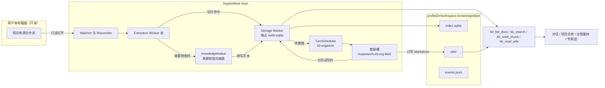

# 知识库模块设计规格（v2.5：工作区隔离 + 双 Worker + 单槽整理 + 可溯源问答）

- 日期：2026-11-25
- 状态：v2.5（M1 `Approved`，M2 受 `M2-0` 旧版 Office 选型门禁约束）。已完成六轮多视角评审与源码校准（[`2026-11-24-knowledge-base-design-review.md`](./2026-11-24-knowledge-base-design-review.md) §10–§17 已收口）；M1（M1-1 / M1-2 / M1-3）可直接进入 `writing-plans`，M2 须先完成 §6.2 / §12 定义的 `M2-0` 预研门禁后再撰写实施计划；尚未写代码
- 基线：外层仓库 `dd68839faf`；`deepseek-harness` pin `1600d8a1e140dcde43a1a0941940a0480712c011`（`dsh-v0.2.1-alpha.2-981-g1600d8a1e1`）
- 范围：HuaAnWork 桌面端左侧边栏「知识库」维护页、多知识库隔离工作区、两阶段事件驱动只读提取与整理流水线、SQLite 增量索引（默认中文 FTS5 + 可选 Embedding 混合检索）、整理 Agent 受控运行与事件流，以及普通对话 / 项目任务 / `@智能体` / 专家团中的会话级多选挂载与可溯源问答
- 约束：全部产品实现收敛在 `dsh-plugin-huaanwork/` 与仓内自有共享包（如 `packages/huaanwork-policy/`）；不修改 `deepseek-harness/` 子模块，不改变未挂载知识库会话与现有 `@智能体` / 专家团的既有语义

---

## 0. 评审校准（相对 v1 与评审稿）

评审共 41 项，方向成立：v1 的 REST 路径、进程内 fs 的 OS 沙箱表述、整理会话身份、同步 SQLite、`sharp`、空工具交集、孙代 `restrict` 时序、提示词插值，都不能按原文实施。下面这些条目保留修法，但故障描述按源码收紧。实施以本节为准，不以评审稿里被收紧的句子为准。

| 议题 | 源码事实 | v2 采用的写法 |
| :--- | :--- | :--- |
| 活性探针 | `host-process.ts` 每 2 秒调用 `status`，单次超时 2 秒。`host-liveness.ts` 在连续无应答 15 秒进入 `suspect`，满 60 秒且仍有回合才进入 `stoppable`。2 秒超时本身不杀 Host | 全部 `node:sqlite` 同步调用放进单独的 Storage Worker，避免主线程堵住 `status`。不把「一次向量点积」写成必然击穿探针 |
| `session_projcache` | 域为 `per-record`（落盘于 `storages/session_projcache/sessions/<sessionId>.json`），按 `SessionId` 存一条检查点，启动 `loadAll` 进内存。隔离阈值是 `SESSION_PROJCACHE_MAX_BYTES = 128 MiB`（`session-projcache-recovery.ts`）。`spec.ts` 写明 SessionId 是槽位，身份含 `createdAt`。`JsonlSessionPersistence.create()` 在 `hasPending` 或日志仍在时抛 `SessionAlreadyExistsError`。`SessionProjectionCache` 无公开删除方法、`table` 私有，且 `storageDomain.open` 拒绝重开已开域；现有 `session.remove` 亦不删该缓存 | 每库固定槽位 `huaanwork-kb-org-<kbId>`。复用前必须 `dispose` 并删掉该槽日志，否则 `create` 会拒绝。删库时**不**操作 `session_projcache`（与 `session.remove` 一致，不改子模块，接受每个已删库最多残留 1 条固定槽位记录）。无界增长来自「每批新 runId」，不是首轮 4,000 条就写满 128 MiB |
| 缺可写根 | `sandbox-cwd.ts` 的 `pinnedCwd` 在没有会话根时夹到前台工作区；没有前台根时用请求路径或 `process.cwd()`。`fs-sandbox` 自述进程内读写不是内核边界，`workspace-write` 还允许平台临时目录 | 整理前缀缺根即拒绝，不回落前台根。源目录允许与项目重叠，回落前台根就可能写到资料目录。进程内工具的写边界是 `decide.ts` 的 `resolveInside`；不把 Seatbelt / Windows ACL 算进这条路径。整理会话额外拒绝平台临时目录 |
| `isLanEndpoint` | `network.ts` 放行回环、RFC1918、链路本地、IPv6 ULA 和 `*.local`，不做 DNS，其它主机名拒绝（`nas.internal` 为拒绝，`gpu-box.local` 为放行） | 视觉与 Embedding 走同一 `knowledgeHttpFetch`。设置文案按上述规则写，不写成「拒绝一切内网域名」 |
| `present-as` 空名单 | `present-as.ts` 在算出的 `allowed` 为空时直接 return，不调用 `tools.restrict`；且当前仅按 `ALLOWED_TOOLS ∪ extra` 放行，不消费会话级白名单 | 新增登记在 `HUAANWORK_CONTEXT_PROPS` 的 `ctx.huaanworkSessionToolAllow: Map<string, readonly string[]>`，由 `present-as.ts` 与 `policy.ts` 双层消费。仅当本会话存在显式白名单（`huaanworkSessionToolAllow` / `huaanworkPackageChildAllow`）、工具 schema 已就绪、交集仍为空时，调用 `restrict({ allow: [] })`。schema 尚未注册时不锁死；`tools/change` 会再次收窄 |
| 三次失败停会话 | `limits.ts` 的 `MAX_CONSECUTIVE_SAME_FAILURES = 3` 只统计同一工具名加同一关键参数 | 从整理白名单去掉 `str_replace_editor`。`decide.ts` 要求 `old_str` 在已有文件中恰好出现一次，`view` / `create` / `insert` 过不了这道检查。三次强杀不是任意三次报错都会发生 |
| 墓碑删除 | 上游 `tool-fs` 没有删除文件的工具 | 宿主只删除登记过的 `wiki/docs/<docId>.md`（`resolveInside`、普通文件、非符号链接、非空校验针对新建笔记）。`INDEX.md` 与 `topics/` 仍由整理 Agent 改写。宿主不按模型给出的 glob 删专题页 |
| `sharp` | `package.json` 的 `devDependencies` 有 `sharp@0.35.5`，图标脚本与 `mac-universal.ts` 已按精确 dylib 路径打包 | 知识库运行时不 import `sharp`。缩放放在 Electron 主进程的 `knowledgeNative`（`nativeImage` / 离屏画布）。`worker_threads` 里没有 Electron 的 `nativeImage` |
| `noAsar` | 只有 `host-process-entry.ts` 调用 `disableAsarArchiveView`。该标志写在当前 `process` 对象上 | 每个知识库 Worker 入口自行调用。打包冒烟放一份损坏 `.asar`。本次校准没有重跑 Electron 活体探针 |
| 路由 | `ROUTE_TABLE` 现为 92 条，四处测试写死该长度。专家团是 `GET /huaanwork/expert-team/get?id=` 与 `POST /huaanwork/expert-team/update`，标识在 query 或 JSON body | 知识库同样表内注册，路径用 `/huaanwork/knowledge/<action>`。不使用 `:id`、`PATCH`、`DELETE` |
| 会话删除 | `project.remove`、`task.remove`、自动化删除不走 `session.remove`，但都进入同步的 `releaseSessionRuntime(ctx, sessionId): void`（不接收 `profileDir`）；启动期 `session-sweep.ts` 直接删存量 `.jsonl` 不走该函数 | `releaseSessionRuntime` 同步清理内存态挂载与附件，并通过注入的串行持久化清理队列异步更新 `session-knowledge.json` 与 `session-citations/<sessionId>.json`；启动加载或 `session-sweep` 后对已删会话做轻量孤立条目剪枝 |
| 右侧预览与纯文本气泡 | 助手正文是纯文本。右侧已有 `right-pane` 的「预览」页。`ArtifactMarkdownView` 只剥 HTTP(S) 图片，YAML 结尾的 `---` 会被 CommonMark 收成 Setext 标题 | 引用芯片来自工具结构化结果，点开走现有预览页。Wiki 用单独的 `WikiMarkdownView`，先剥 frontmatter |

产品边界没有改。旧版 Office、条件视觉转写、可选 Embedding 仍在交付范围内，工程上分成 M1、M2 两段（M2 撰写实施计划前须先完成旧版 Office 选型预研门禁 `M2-0`），发布时两段都要完成。

---

## 1. 背景与需求理解锁定（Understanding Lock）

用户希望在 HuaAnWork 桌面端左侧边栏落地「知识库」模块：用户可新建多个独立知识库，每个知识库以一个本地文件夹作为原始资料仓库，持续向其中放入分类文档；系统内置知识整理 Agent 自动维护该知识库，每当有新资料变动即事件驱动触发整理与增量索引；并在日常对话、项目任务及智能体调用中实现带精准出处的可溯源问答。全链路的核心硬底线是：Agent 与检索链路对用户原始资料目录严格只读，绝不修改、移动、重命名或删除任何用户资料。

已与需求方锁定的核心边界：

1. **页面职责清晰分离**：左侧边栏「知识库」页专注知识库 CRUD、状态监控、整理成果（Markdown 知识视图）只读预览与整理 Agent 事件记录，不设独立问答页。
2. **消费与问答统一入口**：在普通对话与项目任务输入区提供知识库多选挂载（记住会话选择），并向本次会话内调用的 `@智能体` 与专家团自动透传只读检索权限，实现可溯源问答。
3. **两阶段事件驱动协作**：文件变动经防抖与写稳探测后，阶段 1 由宿主秒级完成纯 JS/Node 只读提取与 SQLite 增量索引（新资料立刻可检索）；阶段 2 自动以低优先级按批次唤醒整理 Agent 维护结构化 Markdown 知识视图（支持单库暂停自动整理、暂停目录监听，以及手动重跑）。
4. **双层检索与可选混合开关**：默认内置本地 SQLite 中文全文索引（FTS5；连续汉字单字 unigram、两字及以上 bigram）开箱即用；设置中提供可选的 OpenAI 兼容 Embedding 模型配置。当前模型向量覆盖率达到 95% 后，检索升级为「全文 + 向量」RRF 混合；未达标时保持纯全文。
5. **全办公格式只读覆盖**：零外部运行时依赖（不依赖本机 Python / LibreOffice），纯 JS/Node 覆盖纯文本 / Markdown / CSV / 代码 + 现代 Office（`docx`/`xlsx`/`pptx`）+ 旧版 Office（`doc`/`xls`/`ppt`）+ 文字版 PDF。若用户配置了具备多模态能力的模型（`supports_vision`），则条件支持扫描版 PDF 与图片内容视觉转写，未配置时跳过并给出明确事件提示。
6. **目录重叠规则**：允许知识库源目录与已注册的「项目」目录重叠，但禁止绑定应用自身的 `profileDir`（及其内部子目录或祖先目录），禁止 Windows UNC 与设备路径，也禁止两个知识库绑定相同或父子嵌套的源目录。删库仅移除隔离工作区与索引，绝不触碰用户源目录。

---

## 2. 目标、非目标与非功能性假设（NFRs）

### 2.1 目标

1. 支持多知识库创建、重命名、绑定目录查看、自动整理开关、监听暂停、手动同步、整理待处理、重建索引与安全删除。
2. 在 `<profileDir>/workspace-knowledge/<kbId>/` 建立物理隔离工作区。整理会话的写边界由策略层钉死在 `wiki/`；源目录读取在 Worker 内按 §5.3 的 `realpath` / `lstat` / `open` / `FileHandle.stat` 校验链完成归属核验并仅读单一已开句柄。
3. 提供「实时监听 + 防抖写稳 + 启动/周期指纹对账 + 严格 1 对 1 `sha256` 重命名识别」的事件驱动同步，离线修改不丢事件，批量拖入不打满前台对话。
4. 提供跨 macOS / Windows 的纯 JS 多格式只读提取管线，以及受预算约束的条件多模态视觉转写（扫描 PDF / 图片）。运行时不引入 `sharp`。
5. 为每库维护独立 SQLite 增量切片索引与精确溯源坐标。SQLite 只在 Storage Worker 内同步访问。默认中文 BM25；Embedding 覆盖率达标后才做 RRF，失败或补算期间降级为纯全文。
6. 每库一个可复用整理会话槽，低优先级、可被前台对话抢占，合批维护 `INDEX.md`、`docs/`、`topics/`，并持久化可观察的整理事件。
7. 在对话输入区支持多选挂载知识库，并向 `@智能体` / 专家团 / 普通子代理透传只读检索工具。引用由工具结果渲染，在现有右侧「预览」页打开。

### 2.2 明确非目标（一期不做）

- 不在「知识库」页内构建独立聊天/问答界面。
- 不支持音视频转写（音频/视频文件跳过并记录原因）。
- 不修改「智能体包」签名 manifest 协议，不做智能体包级持久化默认绑定。
- 不做跨机同步、云端备份或团队共享知识库广场。
- 不修改上游子模块 `deepseek-harness/`，不引入外部守护进程、C++ 原生向量库或中文分词扩展。
- 知识库运行时不 import `sharp`，也不把缩放放进 `worker_threads`。

### 2.3 非功能性需求与显式假设

| 维度 | 约束与显式假设 |
| :--- | :--- |
| **规模（Scale）** | 单用户本地使用。软上限：最多 20 个知识库，单库 ≤ 2,000 份有效文件，单文件 ≤ 50 MB。超出则跳过并记告警，不中断同库其它文件。 |
| **资源硬上限** | 解压后的 ZIP 总量 ≤ 50 MB、单条目 ≤ 20 MB、条目数 ≤ 2,000。单文档提取文本 ≤ 10 MB，单文档 ≤ 500 切片，单库 ≤ 50,000 切片。向量维度 ≤ 4,096。向量不全量常驻 Host 堆，由 Storage Worker 按查询做流式 Top-K。`wiki/` 单文件 ≤ 256 KB、单库 ≤ 50 MB。`events.jsonl` ≤ 500 行且 ≤ 512 KB；单条 `summary` ≤ 512 字节、`detail` ≤ 4 KB。`session-citations/<sessionId>.json` 单文件 ≤ 200 条且 ≤ 256 KB（超出丢最旧）。WAL：`journal_size_limit = 32 MiB`，`wal_autocheckpoint = 1000`。Extraction Worker：`resourceLimits.maxOldGenerationSizeMb = 256`。 |
| **性能（Performance）** | 阶段 1 在 3 秒防抖和写稳探测之后入库。单文件解析超时 60 秒，超时只杀掉该 Extraction Worker。目录遍历与对账用 `fs/promises`，多库错峰，不在 Host 主线程做万级 `statSync`。SQLite 不在 Host 主线程执行。Embedding HTTP 超时 5 秒后降级全文。视觉转写代码常量上限前 50 页（`MAX_VISION_PDF_PAGES = 50`，非设置项）、长边 ≤ 1,568 px、并发 1；离屏渲染单次 1–3 页、≤ 30 秒。 |
| **活性与退场** | Host `status` 探针间隔与单次超时都是 2 秒；15 秒无应答为 `suspect`，60 秒且有回合为 `stoppable`。退出与换代时监管进程最多等 `stop` 3 秒然后 `child.kill()`。知识库收尾预算 ≤ 1 秒：置 `disposing`、关掉全部 Watcher，并行取消整理回合、`terminate` Extraction Worker、关闭 Storage Worker 里的 SQLite（900 毫秒仍未结束则终止 Worker）。正常运行期间做轻量 checkpoint，退出路径只 `close()`。 |
| **安全与隐私（Security）** | 源目录只读（Worker 内经 `realpath` 归属校验 + 逐段 `lstat`/`bigint (dev, ino)` 环检 + `open(O_RDONLY \| O_NOFOLLOW[POSIX])` + `FileHandle.stat` 复核后单句柄读取；按单用户本地威胁模型，不宣称抵御同权限恶意进程对中间父目录的纳秒级替换竞态）。整理会话 fail-closed 钉在 `wiki/`，禁止 shell、出网、MCP、平台临时目录和指向库外的符号链接。视觉离屏页零出网，即使 `allow_network=true` 也不放行该页的请求。Chat / Vision / Embedding 的业务 HTTP 仍走全局 `allow_network`。事件与连通性测试输出经过 `maskSecrets()`，不落 API Key，不回显上游 HTTP 正文。`workspace-knowledge/`、`knowledge-bases.json`、`session-knowledge.json`、`session-citations/` 不进 profile checkpoint 与诊断包。 |
| **可靠性（Reliability）** | 离线变更靠启动与周期对账补齐（用户主动「暂停监听」时暂停周期与休眠自动对账并排空在途读句柄，支持 Windows 安全移动目录；`FSWatcher` 异常降级为 `watch-failed` 时仍保留周期对账）。单文件失败隔离。同一 `(doc_id, sha256)` 失败计次上限 3 次（仅模型/回合报错、看门狗超时或回合结束未 mark 计入；抢占取消、手动停止、重绑/重建维护中止、`blocked-*` 与 Host 退场中止不计入）：第 1 次失败退避 1 分钟、第 2 次失败退避 5 分钟、第 3 次失败后进 `organize-failed`（`organize_retry_after = null`）不再自动排期，直到 `sha256` 变化或用户手动重试。重绑与重建走单库互斥维护门闩；重建以 Step 2 `rename(index.sqlite.rebuild, index.sqlite)` 为唯一提交点（提交前失败回滚旧库，提交后失败保留新库降级重试），损坏恢复经 `wiki-reset.pending` / `wiki.stale` 保证 Wiki 重置幂等可恢复。源目录不可用时保留历史索引与知识视图。删库用 `deletingIds` 门闩。休眠唤醒后对未暂停监听的库重建 Watcher 并补一次对账；不持有 `prevent-display-sleep`。 |
| **可维护性（Maintenance）** | 收敛在 `dsh-plugin-huaanwork/` 与 `packages/huaanwork-policy/`。新增路由同步四处长度为 92 的契约测试。新增 `ctx.huaanwork*` holder 在共享护栏里可选链降级。`packages/huaanwork-policy/` 保持纯逻辑、零三方依赖。不新开监听端口。 |

---

## 3. 架构方案对比与选型结论

| 方案 | 核心架构 | 复杂度 / 维护成本 | 可扩展性 | 关键风险与权衡 | 结论 |
| :--- | :--- | :--- | :--- | :--- | :--- |
| **方案 A+（采用）** | Host 内嵌 `knowledge/` 域；一个 Storage Worker 独占 `node:sqlite`；1–2 个 Extraction Worker 做只读解析；每库独立 SQLite；每库一个可复用整理会话槽 | 中 | 高 | 要管 Worker 退场、asar 标志和 Electron 离屏窄接口。与 `expert-team/`、`market/` 同属桌面域，无额外守护进程 | **采用** |
| **方案 A（v1，不采用）** | 同上，但 SQLite 在 Host 主线程，每批新建整理会话 | 中 | 高 | 同步 SQLite 会挡住 2 秒 `status`；每批新 SessionId 使 `session_projcache` 只增不删；REST 路径与现网路由表不一致 | 排除 |
| **方案 B** | 独立 Knowledge Sidecar 子进程 + 本地 IPC/HTTP | 高 / 高 | 高 | 进程生命周期、Host Handover 与孤儿清理对 2,000 份文档是超额设计 | 排除 |
| **方案 C** | 复用「自动化」壳层跑整理 + 全局单 SQLite | 中 / 高 | 低 | 定时语义与文件防抖合批冲突，删库与并发锁更差 | 排除 |

Storage Worker 是 Host 进程内的一个线程，不是方案 B 的子进程。Extraction Worker 崩溃不得带着 SQLite 句柄一起死，所以两类 Worker 分开。

---

## 4. 已核实代码现状与可复用契约

以下按当前基线核实。设计只在这些扩展点接入。

| 现状事实 | 代码证据 | 对本设计的影响 |
| :--- | :--- | :--- |
| 侧边栏已预留 `knowledge` 视图与占位 `KnowledgeBaseView` | `client-huaanwork/KnowledgeBaseView.tsx` | 替换占位内容，不改顶层导航 |
| 跨平台目录选择已封装为 `pickDirectory()` | `client-huaanwork/App.tsx` | 新建与重绑源目录复用它 |
| 右侧已有 `right-pane`「预览」页；助手气泡是纯文本 | `App.tsx` 中 `right-pane` 与预览状态 | 溯源点击打开这一页，不另做抽屉 |
| `ArtifactMarkdownView` 只去掉 HTTP(S) 图片，不剥 YAML，也不接库内文件跳转 | `ArtifactMarkdownView.tsx` | Wiki 预览用新的 `WikiMarkdownView` |
| 自定义上下文属性集中登记在 `HUAANWORK_CONTEXT_PROPS` | `huaanwork-host/holders.ts`；`huaanwork-guardrails/policy.ts` | 新增 holder 都要登记，并在护栏里可选链 |
| 中立目录在 `workspace-state.ts`，启动清扫有排除列表 | `workspace-state.ts`；`index.ts` 里 `sweepProjectLegacySessionsOncePerProcess` 的排除根 | 注册 `workspace-knowledge`，并保护整理会话前缀 |
| `TurnScheduler` 按根单写者，`max_concurrent_turns` 默认 3、范围 1–8。满额时用户回合排队，不抢占已有写者；`QueueItem` 当前未携带 `kbIds`，`startQueuedItem` 仅重建 `text`/`clientMessageId`/`skill`/`at` | `turn-scheduler.ts`；`sessions.ts` | 增加 `kb-organize`（仅因全局满额排队且存在整理写者时先取消整理再准入用户回合）；`QueueItem` 与 `startQueuedItem` 扩展保存已解析的 `clientMessageId` 与不可变 `kbIds` 快照，确保排队回合与并发改选互不串味 |
| `soleCapWriterSessionId()` 统计所有占名额写者 | `turn-scheduler.ts`；`bridge.ts` 用它补 diff 归属 | 整理写者不计入，避免把 git diff 算到整理会话上 |
| 工具可见性链路是 `agent/inbox/claimed` → 附件 → `present-as.ts` → `model.ts` → `policy.ts` → `decide.ts` | `guardrails/present-as.ts`、`model.ts`、`policy.ts`；`packages/huaanwork-policy/src/decide.ts` | 整理工具与 `kb_*` 检索工具走这条链路 |
| `present-as.ts` 在允许列表为空时直接返回，且不消费会话级显式白名单 | `present-as.ts` 计算 `allowed` 之后 | 引入 `ctx.huaanworkSessionToolAllow`（登记在 `HUAANWORK_CONTEXT_PROPS`）；`present-as.ts` 按显式白名单收窄，交集为空时调用 `restrict({ allow: [] })` |
| `@智能体` 与专家团分走 `dispatch()` 与 `dispatchTeamMember()`；`legacy @agent` 在 `agent-invoke.ts` 仅用 `filterAgentAllow(detail?.allow)` 并在 `skills.ts:604,950` 按 `legacy.allow.filter(...)` 收窄；系统技能（`explore`/`test-fix`）在 `skills.ts:340,361,441` 有 `restrictKind` / `tools.guard` / `pre-execute` 三道 `wantedTools(kind)` 门禁；孙代在 `skills.ts:976` 先读 `schemas()` 再 `restrict` | `agent-package/host.ts`；`agent-invoke.ts`；`guardrails/skills.ts` | 按 §9.2 对 5 类子代理分别定义有效 allow 组合与预挂/后挂时序（未挂库时全部保持原样，挂库时 `kb_*` 进入有效白名单与附件并真正可执行） |
| `isTurnBoundaryMessage` 已用于专家团附件，异常时 `agent.cancel` | `turn-anchors.ts`；`expert-team-dispatch.ts` | 知识库挂载监听复制这一门控 |
| `turnOriginForSession` 只区分 `huaanwork-auto-` 与其它；其它都被当成 `advanced`，从而挂上 `result_present` | `sessions.ts`；`result-artifact-tools.ts` | 整理槽前缀单独分支，不挂 `result_present` |
| 侧栏会话过滤只认识自动化前缀；回合锚点 LRU 为 256 | `sessionChannel.ts`；`turn-anchors.ts` 的 `DEFAULT_LIMIT` | 同一前缀过滤列表、事件和锚点 |
| `session.remove` 与项目/任务/自动化删除最终都调用 `releaseSessionRuntime` | `sessions.ts`；`routes.ts` 的 `releaseAndDiscardSession` | 挂载清理写在这一处 |
| 进程内 fs 沙箱不是内核边界；OS 沙箱包的是 shell 子进程。缺会话根时 `pinnedCwd` 回到前台工作区 | `deepseek-harness/packages/fs/fs-sandbox/src/index.ts` 文件头；`sandbox-cwd.ts` | 见 §5.3。不把 OS 沙箱写成整理工具的防线 |
| 系统提示默认插值 `{{name}}`，未知或残缺引用会抛错 | `deepseek-harness/packages/core/system-prompt/src/index.ts` 的 `interpolate` | 知识库提示 `interpolate: false`，且不写入会随入库变化的文档数 |
| 插件注册要同时改 `profile.ts`、`tsdown.config.ts`、`package.json` exports | 现有 `thinking-prompt` 三处 | `knowledge-prompt.ts` 按同一方式接线 |
| `agents.create` 接受 `setup` | `deepseek-harness/packages/core/agent-loop/src/index.ts` 的 `setupAndPublish` | 整理会话提示在该 `setup` 里注册 |
| 路由是表内 `/huaanwork/...`，GET 用 query，POST 用 JSON body，长度为 92 的断言有 4 处 | `routes.ts`；`expert-team-routes.ts`；`api.ts`；`routes.spec.ts`、`api.spec.ts`、`route-contract.spec.ts`、`market-routes.spec.ts` | 新增 `knowledge-routes.ts` 并改这 4 处测试 |
| `writeHuaanworkSettings` 是普通 `writeFile`，无权限位 | `settings.ts` | 设置与两份知识库 JSON 改为 `writeFileAtomic`，文件模式 `0o600` |
| `shell.showItemInFolder` 已在主进程使用 | `electron-runtime.ts` | `knowledge.reveal` 只走这个 API |
| `node:sqlite` 由 Node 22 提供；`disableAsarArchiveView` 只在 Host 入口设置 | `asar-archive-policy.ts`；`host-process-entry.ts` | Worker 入口自己关闭 asar 视图。打包冒烟验证 `node:sqlite`、FTS5 与 Worker |
| `ModelEntry` 没有视觉字段，也没有 Embedding 配置 | `settings.ts` | 增加可选 `supports_vision`、`knowledge_embedding`、`knowledge_vision_model_id` |
| Host 与 Electron 主进程已有窄 RPC（`artifactNative`） | `host-runtime-bridge.ts` | 新增 `knowledgeNative`，无头环境返回明确错误 |

---

## 5. 总体架构、工作区物理隔离与只读边界

### 5.1 架构拓扑



### 5.2 物理目录隔离布局

```text
<profileDir>/
├── knowledge-bases.json                    # 注册表。writeFileAtomic，模式 0o600
├── session-knowledge.json                  # sessionId -> kbIds[]。同样原子写入
├── session-citations/
│   └── <sessionId>.json                    # 按父会话归集父/子回合结构化引用，writeFileAtomic + 0o600
└── workspace-knowledge/
    └── <kbId>/                             # assertSafePathSegment
        ├── index.sqlite
        ├── index.sqlite-wal / -shm
        ├── index.sqlite.rebuild / .bak*    # 重建索引原子切换暂存与崩溃恢复文件，正常期不存在
        ├── wiki-reset.pending / wiki.stale # 损坏重建的 Wiki 幂等重置标记与暂存旧目录，正常期不存在
        ├── events.jsonl
        └── wiki/                           # 整理会话唯一可写根
            ├── INDEX.md
            ├── docs/<docId>.md
            └── topics/<slug>.md
```

- 持久化注册表格式（对齐 `projects.json`，不另加独立 schema 版本信封）：
  - `knowledge-bases.json`：`{ knowledgeBases: KnowledgeBaseRecord[] }`，单条记录固定字段为 `{ id, name, sourceDir, autoOrganize, watchPaused, createdAt }`（`id` 由 `randomUUID()` 生成并过 `assertSafePathSegment`；建库时 `autoOrganize` 默认为 `true`，`watchPaused` 默认为 `false` 且落盘持久化、重启后仍保持暂停监听；源卷是否区分大小写每次启动/绑定时只读重探，不写入记录）。
  - `session-knowledge.json`：保持 `Record<string, string[]>`（`sessionId -> kbIds[]`），不另加版本号。
- 在 `workspace-state.ts` 增加 `neutralKnowledgeBaseDir` 与 `neutralKnowledgeRootPath`。启动清扫排除这个目录。`writable-root.ts` 对整理前缀只返回该库的 `wiki/`；根未登记时拒绝，不夹到前台项目。
- 源目录绑定：
  1. `realpath` 后必须是已存在且可读的目录。
  2. 拒绝 `profileDir` 自身、其子目录和其祖先目录。
  3. 拒绝与另一知识库源目录相同或构成父子嵌套。
  4. 允许与已注册项目目录重叠。
  5. 拒绝 Windows UNC（`\\` 开头）和设备路径（`\\.\`、`\\?\`）。这些路径能触发对外凭据协商。
  6. 删库只删除 `<profileDir>/workspace-knowledge/<kbId>/`、注册表项与会话挂载，不触碰 `sourceDir`，也不操作上游 `session_projcache`（与 `session.remove` 一致；固定单槽已消除无界膨胀，不改子模块）。
- `knowledge-bases.json`、`session-knowledge.json`、`session-citations/` 和整个 `workspace-knowledge/` 排除在 `profile-checkpoint` 与诊断导出之外。

### 5.3 只读边界（按实际机制写）

进程级 OS 沙箱（macOS Seatbelt / Windows ACL）包的是 `bash` / `pwsh` 子进程。整理会话禁止这两项之后，文件工具走的是 Host 进程内的 `fs-sandbox` 加桌面 `decide.ts`。`fs-sandbox` 的文件头写明这是可信代码里的路径检查，不是内核边界，而且 `workspace-write` 允许平台临时目录。因此 v2 不把「OS 沙箱保护整理 Agent 的文件工具」写成安全结论。

实际四层：

1. **源目录读取（对齐仓内 `lan-https-certificate.ts` / `diagnostic-export-worker.ts` 跨平台只读模式）**：扫描、哈希和解析均只读打开，Host 主线程不直接解析用户文件。Extraction Worker 按以下可执行的 macOS / Windows 校验链读取：
   - 绑定或对账开始前规范化 `realSourceRoot = await realpath(sourceDir)`；
   - 异步递归遍历时对每个目录项执行 `lstat(entryPath, { bigint: true })`：若遇到符号链接或 Windows junction / reparse point（`isSymbolicLink()`），先 `realpath` 校验目标必须落在 `realSourceRoot` 内，越界即跳过并记 `symlink-outside-source`；对目录维护 `bigint` `${dev}:${ino}` 已访集合，检测并阻断符号链接环与目录联结环（记 `symlink-loop`）；
   - 提取单文件前，再做一次 `resolvedTarget = await realpath(candidatePath)` 归属校验与 `preInfo = await lstat(resolvedTarget, { bigint: true })`（要求 `!preInfo.isSymbolicLink() && preInfo.isFile()`），随后以 `open(resolvedTarget, constants.O_RDONLY | (process.platform === 'win32' ? 0 : (constants.O_NOFOLLOW ?? 0)))` 只读打开，立即对已打开的 `FileHandle` 调用 `handle.stat({ bigint: true })` 复核 `isFile() && dev === preInfo.dev && ino === preInfo.ino && size <= MAX_FILE_BYTES`（不匹配则关闭句柄并 fail-closed 跳过，留待下次防抖/对账重试）；
   - 后续 `sha256` 哈希计算与格式解析**全程仅消费该已打开的 `FileHandle`**，不按路径二次打开。
   - **安全边界声明**：在单用户本地桌面威胁模型下，该链路完整防御静态/被动越界符号链接、Windows junction / reparse point、目录环及常规并发文件修改；纯 Node `node:fs` 不暴露 `openat` / `RESOLVE_BENEATH`（且 Windows 无 `O_NOFOLLOW`），因此**不宣称**防御同权限恶意本地进程对中间父目录的纳秒级替换竞态，也不为此引入额外原生 C++ / `koffi` 系统调用封装。
2. **整理会话根**：调用 `agents.create` 之前写入 `huaanworkSessionRoots`。`sandbox-cwd.ts` 对 `KB_ORG_SESSION_PREFIX` 缺根直接失败。`dispose` 之后删掉该根。策略层 `resolveInside(wikiRoot)` 拒绝 `wiki/` 以外的路径，包括 OS 临时目录。
3. **工具白名单与载体**：见 §8.1。新增登记在 `HUAANWORK_CONTEXT_PROPS`（`holders.ts`）的 `ctx.huaanworkSessionToolAllow: Map<string, readonly string[]>`（整理槽在 `agents.create` 前写入并在 `dispose` 后删除）。`present-as.ts` 除原有 `schemas ∩ (ALLOWED_TOOLS ∪ extra)` 外，再与 `huaanworkSessionToolAllow.get(sessionId)`（以及如有 `huaanworkPackageChildAllow.get(sessionId)`）取交集；存在显式白名单且 `schemas()` 非空但交集为空时，调用 `tools.restrict({ allow: [] })`。`policy.ts` 的 `pre-execute` 与 `tools.guard` 对不在 `huaanworkSessionToolAllow` 内的工具直接返回 `deny`。整理槽**不登记** `ctx.huaanworkUnattended`（避免耦合自动化 `UnattendedScope` 与 `automations/<id>.audit.jsonl`）：白名单内全部工具在 `decide.ts` 均为纯 `ALLOW` / `DENY`、绝不返回 `ask`，其余工具（含 `skill`、`request_input`、`exit_plan_mode`）已被白名单彻底拦截，不会触发无人审批挂起。
4. **禁止的能力**：`bash`、`pwsh`、`web_fetch`、`screenshot`、`git_*`、`subagent`、`call_host_tool`、`mcp__*`、`result_present`、`expert_team_dispatch`。整理槽不注册回合锚点，因此也不会因为被当成 `advanced` 而挂上 `result_present`。

`knowledge.reveal` 只接受 `(kbId, docId | relPath?)`，`realpath` 必须落在该库已注册的 `sourceDir` 内，然后调用 `shell.showItemInFolder`。不调用 `shell.openPath`。该操作不给源目录加写 ACL。

---

## 6. 两阶段事件驱动流水线与多格式只读提取

### 6.1 监听、防抖与离线对账

- 每个启用且未暂停监听的知识库有一个 `fs.watch(sourceDir, { recursive: true })`。必须注册 `error` 处理：出错后关闭坏 Watcher、把库标为 **`watch-failed`**（监听异常，已降级为定时/手动同步），保留索引，并继续自动执行 5 分钟周期对账与手动「同步文件」。
- 单库提供用户主动**「暂停监听」**（`knowledge.update({ id, watchPaused: true })`，持久化落盘）：
  1. 立即关闭 `FSWatcher` 句柄；
  2. 取消待触发的 3 秒防抖计时器并清空该库 `dirtyPaths`；
  3. **暂停**该库的 5 分钟周期对账与休眠唤醒自动对账（暂停期间仅用户显式点击「同步文件」才执行一次性对账）；
  4. 中止并等待该库全部在途目录扫描与 Extraction Worker 读取任务的 `FileHandle` 彻底关闭（超时兜底 `terminate` 该 Worker）**之后再返回应答**（在途阶段 2 整理只读写 `index.sqlite` 与 `wiki/`，不触碰 `sourceDir`，无需因暂停监听中止）。
  由此保证「暂停监听」返回成功后对 `sourceDir` 零目录/文件句柄占用，可在 Windows 上直接移动或重命名源目录。恢复监听（`watchPaused: false`）时重新建立 Watcher 并立即补一次增量对账。
- 变更进入单库 `dirtyPaths`，静默 3 秒后进入阶段 1。提取前对每个文件做一次写稳探测：间隔 300 毫秒复核 `size` 与 `mtimeMs`。
- 启动（仅对 `!watchPaused` 的库）、新建、恢复启用（`watchPaused` 从 `true` 切回 `false`）、用户点击「同步文件」、每 5 分钟（仅对 `!watchPaused` 的库，含 `watch-failed` 降级库），以及系统从休眠恢复时（仅对 `!watchPaused` 的库），异步递归对账 `(relPath, size, mtimeMs)`。多库错峰。两项都没变则不读正文。
- 不调用 `prevent-display-sleep`。`powerMonitor` 的 `resume` 与单调时钟大跳变用来对 `!watchPaused` 的库重建 Watcher、补对账，并让整理看门狗忽略这段时钟跳变。
- 重命名复用在「同一次定期/启动对账」以及「实时监听 3 秒防抖形成的同一批 `dirtyPaths` 同步」里统一适用：本批内消失路径恰好 1 条、新增路径恰好 1 条，且两者 `sha256` 相同。此时原地更新 `rel_path` / `norm_path` 并记 `file_renamed`，切片、向量和整理结果继续用。多对多或内容重复时按新增加删除处理，避免把副本认成重命名。
- `norm_path` 是对账用的普通索引，不是 `UNIQUE`。建库时用只读探测判断源卷是否区分大小写（对已存在目录的两种大小写拼写做 `realpath`/`stat`，不创建文件）。不区分大小写的卷上，仅大小写变化走重命名规则；区分大小写的卷上，两种拼写是两个文档。
- 忽略：`~$*`、`*.tmp`、`*.part`、`*.crdownload`、`.DS_Store`、`Thumbs.db`、`desktop.ini`、`.git/`、`node_modules/`、`__pycache__/`。对云盘占位文件先看属性，不把「未水合」当成一批内容变更去打视觉或全文解析（在 Windows / OneDrive 真机验证）；若当前平台无该属性或属性读取失败，按普通本地文件进入阶段 1，并记录一条 `info` 事件（不得因属性探针不可用而跳过整批）。具体 Win32 / OneDrive 属性常量留待实施计划。
- 单文件 > 50 MB，或单库有效文件已达 2,000，记 `file_skipped` 并继续其它文件。

### 6.2 阶段 1：Extraction Worker

默认并发 1，上限 2。每个 Worker 入口第一行调用 `disableAsarArchiveView(import.meta.url)`，并设置 `maxOldGenerationSizeMb: 256`。单文件 60 秒超时后 `terminate` 并另起 Worker，该文件记 `extract-timeout`。Worker 不打开 SQLite，解析结果通过消息交给 Storage Worker 入库。

输出 `ExtractedDocument { format, extractMode, extractConfigHash, sections }`。`extractConfigHash` 覆盖解析器版本、视觉开关、视觉模型标识和页数上限。配置变化而 `mtime+size` 未变时，靠它发现「以前跳过的扫描件现在可以补」。

| 格式分组 | 扩展名 | 策略 | 溯源坐标 | 里程碑 |
| :--- | :--- | :--- | :--- | :--- |
| 文本 / 代码 / 表格文本 | `.md` `.txt` `.csv` `.tsv` `.json` `.yaml` `.yml` `.xml` `.html` 与常见源码后缀 | UTF-8 / GB18030。HTML 去标签并保留标题与行号。文本总量受 §2.3 上限约束 | `{ kind: 'line', startLine, endLine }` | M1 |
| 现代 Office | `.docx` `.xlsx` `.pptx` | ZIP 解析设条目数、单条目和解压总量上限，超限即 `skipped`，不把压缩炸弹展开进堆。`.xlsx` 每个切片保留表头行 | 段/章节；`{ kind: 'sheet', sheet, rowStart, rowEnd }`；`{ kind: 'slide', slide }` | M1 |
| 文字 PDF | `.pdf` | `pdfjs-dist` 提取文字层。打包 `cmaps/` 与 `standard_fonts/`，打包冒烟用一份中文 CID PDF 校验不是乱码 | `{ kind: 'page', page, mode: 'text' }` | M1 |
| 旧版 Office | `.doc` `.xls` `.ppt` | **受 `M2-0` 前置选型门禁约束**（当前规格阶段尚未锁定最终库，不阻断 M1）。撰写 M2 实施计划前须完成预研并回填本表，逐格式确定纯 JS 解析库与精确版本（或经审计纯 JS OLE2/CFB 读取器之上的自有实现）、通过 `verify:licenses` / `verify:notices` 与零原生二进制核查，并用标准 UTF-16LE 中文、Word FastSave、`.xls` BIFF8/BIFF5、`.ppt` 文本原子及加密/损坏样本确定支持矩阵；不支持的流一律 fail-closed 为 `skipped`（带明确 `status_reason`），绝不猜文本或复活 FastSave 已删正文 | 与现代 Office 同构；做不到页级定位时坐标降为文件级并在状态里说明 | M2（前置 `M2-0`） |
| 图片与扫描 PDF | `.png` `.jpg` `.jpeg` `.webp`；文字过少且含图像的 PDF 页 | 见 §6.3 | `{ kind: 'page', page, mode: 'vision' }` 或 `{ kind: 'image' }` | M2 |

`tsdown.config.ts` 显式列出 Extraction Worker 与 Storage Worker 入口。新增解析依赖在合入前通过许可证门禁与打包体积检查（现有 1,500 个文件 / 128 MiB 量级的打包约束仍有效）。M1 解析依赖边界已锁定：文本/HTML/CSV 走纯 JS、OOXML 基于现有 `adm-zip` + 轻量纯 JS XML 解析、文字 PDF 锁定 `pdfjs-dist`（Apache-2.0）并打包 `cmaps/` 与 `standard_fonts/`。M2 的旧版 Office（`.doc`/`.xls`/`.ppt`）解析选型明确列为 **`M2-0` 前置技术选型与样本验证门禁**：该门禁不阻断 M1 计划与实现，但在开始撰写 M2 实施计划前必须先完成预研并将锁定后的库、版本、SPDX 许可证清单、样本支持矩阵与 fail-closed 降级边界回填至本节。

### 6.3 条件多模态视觉转写（M2）

- `ModelEntry.supports_vision` 默认 false。`knowledge_vision_model_id` 为空时，选用当前激活且 `supports_vision === true` 的模型；没有则关闭视觉转写。设置页给出这个下拉框和当前是否生效。
- 独立图片，以及 PDF 中非空字符少于 30 且含图像/绘图指令的页，视为视觉页。
- 优先抽取 PDF 里嵌着的整页图像。需要渲染时才调用 `knowledgeNative.renderPdfPages`。缩放在 Electron 主进程完成，长边 ≤ 1,568 px。Worker 不加载 `sharp`，也不调用 `nativeImage`。
- 离屏窗口对齐 Artifact 窗口的隔离强度，并加上视觉页特有的限制：`show: false`、`offscreen: true`、`sandbox: true`、`nodeIntegration: false`、`contextIsolation: true`、`webSecurity: true`、`plugins: false`；不加载业务 `preload`；独立非持久 `partition`；`webRequest.onBeforeRequest` 无条件拒绝该 partition 的全部请求（不受 `allow_network` 影响）；禁止导航、重定向、弹窗和权限请求。单次 1–3 页，超时 30 秒。`adoptHostShell()` 与 `prepareToQuit()` 销毁窗口和缓存。
- 转写请求走 `knowledgeHttpFetch`：只允许 `http:` / `https:`，`redirect: 'manual'`，超时，`readCappedBytes`，并套用 `allow_network` 与 `isLanEndpoint`。
- 单份 PDF 视觉转写页数上限固定为代码常量 `MAX_VISION_PDF_PAGES = 50`（非 M2 设置项，不增加页数输入框），超出页标 `partial`。该常量参与 `extract_config_hash` 计算，仅用于未来版本调整常量后能触发「补全此前跳过或截断的扫描件」。未开视觉时，图片为 `skipped`，混合 PDF 的文字页照常入库。
- `documents.extract_config_hash` 变化后，知识库页显示「补全此前跳过或截断的扫描件（N 份）」。仅点「同步文件」且 `mtime+size` 未变时，不会悄悄重跑这些文件。

### 6.4 重绑源目录与重建索引的数据转换契约

单库删库（`deletingIds`）与维护操作（重绑 `sourceDir`、重建索引 `knowledge.rebuild`）共用同一**单库互斥维护门闩（`maintainingIds`）**。维护进行中拒绝同库并发的 `sync`、`organize`、`rebuild` 与 `update(sourceDir)`（返回明确繁忙错误 `knowledge-base-busy`）。进入维护前统一执行**停机序列**：停 Watcher → 清防抖计时器与 `dirtyPaths` → 取消本库在途提取并等待其 `FileHandle` 关闭 → 若存在在途整理回合则发出取消（按 §8.1 外部中止口径，**不递增** `organize_attempts`）并 `await inFlightOrganizeByKb`。

1. **重绑源目录（`knowledge.update({ id, sourceDir })` / 「重新选择文件夹」）**：
   - **前置校验零副作用**：先对新 `sourceDir` 执行 §5.2 全部路径校验（`realpath` 可读目录、排除 `profileDir`/子/祖先、排除同其它库相同或父子嵌套、拒绝 UNC/设备路径）。任一校验失败直接返回错误，**不关闭旧 Watcher、不改写 `knowledge-bases.json`、不动索引与 `wiki/`**。
   - **保留既有资产并增量收敛**（同时覆盖「Windows 移动原文件夹后重绑」与「换绑到新目录」两类场景）：通过校验并完成停机序列后，原子写回 `knowledge-bases.json`（`writeFileAtomic + 0o600`），只读重探新目录所在卷的大小写敏感性，解除 `source-unavailable`，**保留 `index.sqlite` 与 `wiki/` 不清空**，按 `!watchPaused` 重启 Watcher，并立即触发一次全量对账（**本次重绑对账禁用跨目录 1 对 1 `sha256` 重命名猜配**，仅按 `rel_path` 匹配）：
     - 同 `rel_path` 且内容未变（`sha256` 与 `extract_config_hash` 均一致，即使跨盘复制改变了 `mtime_ms`）：保留原 `doc_id`、切片、向量、`wiki/docs/<docId>.md` 与 `organized_sha256`，仅更新 `mtime_ms`/`size`，零模型重跑；
     - 同 `rel_path` 但内容已变（`sha256` 不同）：保留该 `rel_path` 既有 `doc_id`，重提并替换 `chunks`/`chunks_fts`/`chunk_embeddings`，清零 `organize_attempts = 0` / `organize_retry_after = null` / `last_organize_error = null`，由阶段 2 更新既有卡片；
     - 旧目录存在、新目录已消失的文件：从 `documents`/`chunks`/`chunks_fts`/`chunk_embeddings` 删除，并将原带 `wiki_note_path` 的记录写入 `organize_tombstones`（下一批整理清理旧卡片并更新 `INDEX.md`/`topics/`）；
     - 新目录新增的文件：生成新 `doc_id = randomUUID()` 入库待整理。
   - **失败与中断恢复**：`knowledge-bases.json` 原子写盘前失败则完全保留旧 `sourceDir` 与旧数据；写盘后、对账完成前若 Host 崩溃，下次启动对账会基于已落盘的新 `sourceDir` 自动收敛，无半迁移中间态。记录 `source_rebound` 事件。
   - **历史引用**：未变更文档的引用继续实时命中；变更或消失文档的引用由 §9.1 的版本指纹校验自动回落展示保存的 `excerpt`。

2. **重建索引（`knowledge.rebuild({ id })`）**：
   - **前置校验**：校验 `sourceDir` 当前存在且可读；若处于 `source-unavailable` 直接拒绝并保留旧索引与 `wiki/`（提示先重新选择文件夹）。
   - **暂存库构建与 `doc_id` / `wiki/` 语义**：执行停机序列并将阶段标为 `rebuilding`。Storage Worker 在隔离目录下新建暂存库 `index.sqlite.rebuild`（同 Schema 与 PRAGMA）：
     - **正常重建（旧 `index.sqlite` 可打开且通过 `PRAGMA quick_check`）**：从旧库只读快照 `rel_path -> { doc_id, wiki_note_path, organized_sha256 }`。对 `sourceDir` 全部有效文件强制忽略 `(size, mtime_ms)` 缓存重新提取并写入暂存库：`rel_path` 命中快照则沿用原 `doc_id`（维护 §7.1 `doc_id` 永久不变契约）与 `wiki_note_path`，仅当新 `sha256 === snapshot.organized_sha256` 且盘上 `wiki/docs/<docId>.md` 仍为有效非空常规文件时沿用 `organized_sha256`，否则置 `organized_sha256 = null` 交由阶段 2 重新整理；新文件生成新 `doc_id = randomUUID()`；快照中已消失且有 `wiki_note_path` 的文件写入新库 `organize_tombstones`。所有 `chunks`、`chunks_fts`、`chunk_embeddings`、`organize_attempts`（全归 0）、`organize_retry_after`（全 `null`）、`last_organize_error`（全 `null`）均在新库从零重建，**不清空 `wiki/` 目录**。
     - **损坏恢复重建（旧 `index.sqlite` 无法打开或 `quick_check` 失败）**：无法读取旧映射时，为全部文件分配新 `doc_id = randomUUID()`；在进入下方提交点（Step 2）前先落盘 `<kbDir>/wiki-reset.pending`（`writeFileAtomic + 0o600`），待提交点成功后执行可恢复的幂等 Wiki 重置并触发重新整理，在 `rebuild_completed` 事件与界面中显式告知「检测到旧索引损坏，已全新重建索引并重置知识视图」。
   - **提交点与原子切换协议**：全部文件入暂存库后，Storage Worker 对 `index.sqlite.rebuild` 执行 `PRAGMA wal_checkpoint(TRUNCATE)` 并关闭；对旧 `index.sqlite` 尽力执行 `wal_checkpoint(TRUNCATE)` 并关闭；随后执行严格有序的切换：
     1. **Step 1（移走旧库与伴随 WAL/SHM）**：将旧 `index.sqlite` 移为 `index.sqlite.bak`，同时将残留的旧 `index.sqlite-wal` / `index.sqlite-shm`（如有）一并移为 `index.sqlite.bak-wal` / `index.sqlite.bak-shm`（既避免旧 WAL 污染新库，也保证提交前回滚零数据损失）。损坏恢复重建在此前已写好 `wiki-reset.pending`。
     2. **Step 2（唯一提交点 / Commit Point）**：执行 `rename(index.sqlite.rebuild, index.sqlite)`。该步成功即标志新索引正式生效。
     3. **提交前失败（Step 2 成功之前的任意阶段，含提取中止、磁盘满、主动取消、Host 退场、Step 1/Step 2 文件锁）**：**回滚并保留旧库与旧 `wiki/` 完好无损**——若 Step 1 已执行则将 `index.sqlite.bak*` 移回 `index.sqlite*`，清理 `index.sqlite.rebuild*` 与未提交的 `wiki-reset.pending`，重新打开旧库并记录 `rebuild_failed`。
     4. **提交后收尾（Step 2 成功之后，绝不回滚旧库，按项降级与幂等重试）**：
        - **Wiki 幂等重置（仅存在 `wiki-reset.pending` 时）**：若 `wiki/` 存在且 `wiki.stale` 不存在，则 `rename(wiki/, wiki.stale)`；随后 `mkdir(wiki/)` 建出空目录并删除 `wiki-reset.pending`；最后尽力异步删除 `wiki.stale`。若 `rename(wiki/, wiki.stale)` 或建空目录失败（如临时文件锁），**保留 `wiki-reset.pending`**，在重置完成前拒绝一切对该库失配旧 `wiki/` 的读取（`knowledge.wikiTree` / `knowledge.wikiFile` / `kb_read_wiki`）与整理写入，置阶段/提示 `wiki-reset-pending`、记录 `wiki_reset_failed` 并在界面提供「重试重置知识视图」按钮（复用现有 `knowledge.sync` 入口先续做幂等重置再继续同步，不新增路由；重启时亦自动续做）。
        - **清理备份**：尽力删除 `index.sqlite.bak*`；失败仅记告警，留待下次启动或维护清理。
        - **重开新主库**：打开新的 `index.sqlite`；若重开失败，**保持新库不回滚**、将库标为 `index-error` 并记错误事件，用户可点击重试（复用 `knowledge.sync` 先尝试重开）或再次触发 `knowledge.rebuild`。
        - **恢复运行态**：若 `!watchPaused` 则恢复 Watcher（失败按 §6.1 降级为 `watch-failed` 保留周期/手动对账）；触发 M2 向量回填与（开启 `autoOrganize` 且无未决 `wiki-reset.pending` 时）整理排期（失败由后续调度或手动触发重试）；记录 `rebuild_completed`。
   - **崩溃重启自动恢复（Storage Worker 启动初始化，按三文件联合状态唯一判定）**：
     - **未提交分支（`index.sqlite.rebuild` 仍存在 → Step 2 从未成功）**：若 `index.sqlite` 缺失且 `index.sqlite.bak` 存在，先将 `index.sqlite.bak*` 恢复为 `index.sqlite*`；随后无条件清理 `index.sqlite.rebuild*`、多余 `index.sqlite.bak*` 与未提交的 `wiki-reset.pending`（旧库与旧 `wiki/` 完整恢复）。
     - **已提交 / 常规分支（`index.sqlite.rebuild` 不存在）**：先清理任何残留 `index.sqlite.bak*`；若存在 `wiki-reset.pending`，按上述幂等步骤续做 Wiki 重置（若 `wiki.stale` 不存在则 `rename(wiki/, wiki.stale)`，确保空 `wiki/` 存在后再删除 `wiki-reset.pending`；失败则继续保持 `wiki-reset-pending` 拦截失配读取并提示重试）；最后无条件清扫任何残留 `wiki.stale*`。
   - **历史引用**：正常重建保留 `doc_id`，内容与 `extract_config_hash` 均未变的切片引用继续实时命中；内容/提取配置变化或损坏恢复重置 `doc_id` 后，历史引用经 §9.1 指纹校验命中 `version-mismatch` / `chunk-missing` 并优雅回落 `excerpt`。

---

## 7. 增量索引、混合检索与溯源

### 7.1 Storage Worker 与 Schema

一个长期 Storage Worker 串行执行全部 `node:sqlite` 调用（`DatabaseSync` 是同步 API）。Host 只发命令和收结果。`PRAGMA journal_mode = WAL`、`foreign_keys = ON`、`busy_timeout = 5000`、`journal_size_limit = 33554432`、`wal_autocheckpoint = 1000`。`user_version` 管迁移。打包冒烟在 `ELECTRON_RUN_AS_NODE=1` 下检查 Worker、`node:sqlite` 和 FTS5。

```sql
CREATE TABLE documents (
  doc_id TEXT PRIMARY KEY,
  rel_path TEXT NOT NULL UNIQUE,           -- POSIX '/'
  norm_path TEXT NOT NULL,                 -- 普通索引，不设 UNIQUE
  sha256 TEXT NOT NULL,
  size INTEGER NOT NULL,
  mtime_ms INTEGER NOT NULL,
  format TEXT NOT NULL,
  extract_mode TEXT NOT NULL,              -- 'text' | 'vision' | 'mixed' | 'none'
  extract_config_hash TEXT NOT NULL,
  status TEXT NOT NULL,                    -- 'indexed' | 'partial' | 'skipped' | 'error'
  status_reason TEXT,
  wiki_note_path TEXT,                     -- 只允许 'docs/<docId>.md'
  organized_sha256 TEXT,
  organize_attempts INTEGER NOT NULL DEFAULT 0,
  organize_retry_after INTEGER,
  last_organize_error TEXT,
  updated_at INTEGER NOT NULL
);
CREATE INDEX idx_documents_norm_path ON documents(norm_path);

CREATE TABLE organize_tombstones (
  doc_id TEXT PRIMARY KEY,
  rel_path TEXT NOT NULL,
  wiki_note_path TEXT,
  deleted_at INTEGER NOT NULL
);

CREATE TABLE chunks (
  chunk_id TEXT PRIMARY KEY,
  doc_id TEXT NOT NULL REFERENCES documents(doc_id) ON DELETE CASCADE,
  ordinal INTEGER NOT NULL,
  heading_path TEXT NOT NULL DEFAULT '',
  locator_json TEXT NOT NULL,
  content TEXT NOT NULL,
  tokenized TEXT NOT NULL,
  char_count INTEGER NOT NULL
);
CREATE INDEX idx_chunks_doc_ordinal ON chunks(doc_id, ordinal);

CREATE VIRTUAL TABLE chunks_fts USING fts5(
  chunk_id UNINDEXED,
  rel_path,
  heading_path,
  tokenized,
  tokenize = 'unicode61'
);

CREATE TABLE chunk_embeddings (
  chunk_id TEXT NOT NULL REFERENCES chunks(chunk_id) ON DELETE CASCADE,
  model_key TEXT NOT NULL,                 -- hash(base_url + NUL + model + NUL + dims)
  dims INTEGER NOT NULL,
  vector_blob BLOB NOT NULL,
  updated_at INTEGER NOT NULL,
  PRIMARY KEY (chunk_id, model_key)
);
CREATE INDEX idx_chunk_embeddings_model ON chunk_embeddings(model_key);
```

`doc_id` 在文件首次入库时用 `randomUUID()` 生成，此后永久不变，不得从路径派生（正常重建索引按 §6.4 继承既有 `doc_id`；唯一例外是旧 `index.sqlite` 损坏不可读时的损坏恢复重建）；1 对 1 重命名只更新 `rel_path` 与 `norm_path`（确保 `wiki/docs/<docId>.md` 路径与既有切片/向量/整理记录恒定不变），并同步更新该文档对应 `chunks_fts` 行的 `rel_path`。`chunks_fts` 为独立 FTS5 虚拟表，不受 `chunks` 表 `ON DELETE CASCADE` 级联覆盖；单文档重索引、删文档与重建索引必须在同一事务内显式删除并重建对应 `chunks_fts` 行（或由同事务触发器同步维护），不得残留僵尸全文条目。`chunk_id` 不承担跨历史重开的定位主键职责。切片按标题、PDF 页内段落、工作表行批（每片带表头）、幻灯片和 Word 标题段落切，目标 500–800 字，相邻重叠约 100 字。

### 7.2 中文全文与混合检索

- 索引列是预处理后的 `tokenized`，并且 `rel_path`、`heading_path` 也写入预处理结果，不只切正文。连续汉字：单字同时发 unigram；两字及以上发 bigram。英文和数字保持整词并小写。
- 查询先去掉 FTS5 运算符（`-`、`:`、`OR`、`AND`、`NOT`、`*` 等），再按词加双引号。单库内取 Top-60 后用原短语和邻近度加分，取单库前 30。`kb_search` 的 `topK` 默认 `8`、上限 `20`（`kb_list_docs` 的 `limit` 默认 `50`、上限 `200`）。
- Embedding 是 M2。`AppSettings.knowledge_embedding` 为 `{ enabled, base_url, model, api_key }`。写入在全文入库之后异步分批调用 `/v1/embeddings`。换模型只新增 `(chunk_id, model_key)` 行，不覆盖其它模型。
- 检索启用 RRF 的条件是：当前 `model_key` 对可嵌入切片的覆盖率 ≥ 95%。未达标时 `searchMode = 'fts-backfilling'`，结果完全来自全文。HTTP 超时或报错时 `searchMode = 'fts-fallback'`。单库内 RRF 使用 `score = Σ 1/(60 + rank)`，全文与向量各取 Top-30。点积在 Storage Worker 里用游标和固定大小的堆完成，不把各库向量一次性载入 Host。
- **多库联合排序**：因各库独立 SQLite 的原始 BM25 分值不可跨库直接比较，多库检索时各库先独立产出内部有序候选（最多 Top-30），再在合并层按单库内名次用倒数排名 `1 / (60 + rankInKb)`（若含精确原短语命中再加固定小权重）做跨库归并并截断到 `topK`，确保不同体量知识库公平竞争。
- 返回字段：`{ kbId, kbName, docId, relPath, sha256, extractConfigHash, chunkId, ordinal, headingPath, locator, excerpt, score, stale, sourceUnavailable, searchMode }`。返回前对命中的少量源文件做 `stat`；`size` 或 `mtimeMs` 与索引不一致则 `stale: true`。源目录不可用时 `sourceUnavailable: true`，仍可返回已索引片段。

---

## 8. 整理 Agent、调度与事件

### 8.1 单库单槽与工具

常量 `KB_ORG_SESSION_PREFIX = 'huaanwork-kb-org-'`。每库槽位 ID 为 `huaanwork-kb-org-<kbId>`，没有每批一个 `runId`。

调用顺序：

1. 确认没有活的 `AgentHandle`。若上次崩溃留下该 ID 的 jsonl，先 `removeSessionFilesById`。`create()` 见到 pending 或日志会抛 `SessionAlreadyExistsError`。
2. 写入 `huaanworkSessionRoots` 指向 `wiki/`，写入 `huaanworkSessionToolAllow` 为整理白名单（6 个 fs 工具 + 3 个 `kb_org_*`），并挂上 3 个 `kb_org_*` 附件；**不登记** `huaanworkUnattended`。读取当前 `settings.active_model_id` 写入 `huaanworkSessionModels`（不回落前台标签模型，也不为知识库另存模型 id），执行 `resolveSessionModel` 并同时校验 `resolved.ok && resolved.model.trim().length > 0`（因 `resolveSessionModel` 不拦 `model: ''` 缺省条目）；条目不存在或 `model` 为空记 `blocked-no-model`，网络门禁拒绝记 `blocked-network`，均直接中止并不空转重试。
3. `ctx.agents.create({ sessionId, setup })`。`setup` 里用 `systemPrompt.context({ interpolate: false })` 放入固定整理说明（库名中的 `{{` 不得被当成变量）。
4. 批次结束 `await handle.dispose()`，清理 `huaanworkSessionModels.delete(sessionId)`、`huaanworkSessionRoots.delete(sessionId)`、`huaanworkSessionToolAllow.delete(sessionId)` 与该槽附件（下一批重新快照最新的 `settings.active_model_id`），再删该槽日志。下一次批次是空历史。投影缓存的键就是这个 SessionId，新生命周期会按 `createdAt` 重新匹配；删库时**不**调用上游 `session_projcache` 删除（无公开接口，与 `session.remove` 一致，每个已删库至多残留 1 条记录）。
5. 20 个库最多 20 条整理槽缓存，外加用户自己的会话。这不是「首轮就会写到 128 MiB」，而是避免每批一条、只增不删，最终触发 `SESSION_PROJCACHE_MAX_BYTES` 的隔离恢复。

可见性隔离，前缀全部生效：

- `session.list` 与客户端 `sessionChannel` 不展示。
- 不把该会话的 token / tool / diff 写进用户对话流（与自动化前缀同一类早退）。
- `turnOriginForSession` 返回 `'knowledge'`。`result_present` 只在 `'advanced'` 挂载。
- `installTurnAnchorHooks` 对该前缀直接返回，不占用 256 条锚点 LRU。
- `bridge.ts` 不对该前缀调用 `emitGitDiff`，`soleCapWriterSessionId()` 也不把它算成唯一写者。
- `session-sweep.ts` 保留该前缀，并继续排除 `neutralKnowledgeBaseDir`。

工具白名单：

- `wiki/` 内：`read`、`read_file`、`glob`、`grep`、`write`、`edit`。不含 `str_replace_editor`。路径经 `resolveInside(wikiRoot)`，策略 `ALLOW`，不弹审批。
- 三个宿主工具，作用域锁在当前 `kbId`，进入 `SESSION_ATTACHED_TOOLS`、`isRegisteredToolName` 和 `decide.ts` 的显式 `ALLOW`：
  1. `kb_org_get_delta()`：本批待整理文档，以及 `organize_tombstones`。跳过 `organize_retry_after` 未到或已达 3 次的文档。
  2. `kb_org_read_doc({ docId, startOrdinal?, limit? })`：默认最多 12 片。
  3. `kb_org_mark_organized({ processed, clearedTombstones?, summary })`：对每个 `processed` 项，目标文件必须是 `wiki/docs/<docId>.md`，普通文件，非符号链接，非空，≤ 256 KB。然后执行 `UPDATE documents SET organized_sha256 = ?, wiki_note_path = ? WHERE doc_id = ? AND sha256 = ?`。条件不中则不推进指纹。墓碑只有在 Agent 已经改完 `INDEX.md` / `topics/` 之后才清除。宿主删除的是表里记下的那一个 `docs/<docId>.md`，不接受任意专题路径。

失败计次与退避口径（严格区分「外部中止」与「整理失败」）：

- **不计数**（保持 `organize_attempts` 与 `organize_retry_after` 不变）：被用户回合抢占取消、用户手动点击停止整理（`knowledge.organizeCancel`）、因重绑/重建维护门闩触发的中止、因缺模型/空模型进入 `blocked-no-model`、因网络门禁进入 `blocked-network`，以及 Host 退出/换代导致的中止。
- **计为失败**（对本批中所有尚未通过 `kb_org_mark_organized` 成功推进的文档，各执行 `organize_attempts += 1` 并写入 `last_organize_error`）：模型或回合执行异常报错、空闲看门狗超时、或整理回合正常结束但 Agent 未对对应文档成功调用 `kb_org_mark_organized`（防跳过文档导致无限循环调用模型）。
- 同一 `(doc_id, sha256)` 第 1 次失败设 `organize_retry_after = now + 60_000`（1 分钟），第 2 次失败设 `organize_retry_after = now + 300_000`（5 分钟），第 3 次失败后进入 `organize-failed` 且 `organize_retry_after = null`、不再自动排期，直到 `sha256` 变化或用户经 `knowledge.organize({ id, docId })` / `retryFailed: true` 清零重置。空批次不启动模型。

### 8.2 调度

`TurnScheduler` 增加 `kind: 'kb-organize'`：

1. 同一 `wiki/` 根同时只有一个整理回合。回合结束后若仍有到期文档，再排队下一批。每批最多 10 份文档或 80 KB 切片文本。
2. 全局同时只有一个 `kb-organize`。
3. 仅当 `admitUserTurn` 满足 `!rootWriters.has(root) && activeTurns >= options.maxConcurrentTurns()`（即仅因全局并发满额而非同根忙碌导致即将排队）且当前占名额写者里有 `kb-organize` 时，向该整理回合发出取消并立即释放全局并发名额准入用户（若同根已有写者则直接排队，不无谓打断整理；整理收尾 `finally` 幂等跳过二次扣减 `activeTurns`）。**全局并发名额释放与单库整理槽生命周期锁显式解耦**：Knowledge Host 维护 `inFlightOrganizeByKb: Map<kbId, Promise<void>>`，同库下一次 `ctx.agents.create()` 或 `knowledge.remove` 必须 `await` 前一次的 `inFlightOrganizeByKb`（直到旧 `handle.dispose()` 与 `removeSessionFilesById()` 彻底结算），杜绝复用单槽时触发 `SessionAlreadyExistsError`。取消不写 `organized_sha256`、也不递增 `organize_attempts`；已写了一半的 Markdown 留到下一批覆盖；Storage Worker 自己的事务不因取消而拆开。
4. 整理唤醒放在 `drainQueue()` 和 `evaluateDueAutomations()` 之后。用户队列非空时不启动整理。
5. 默认 3 个并发槽位时，整理只占用一个槽；用户把并发设为 1 时，靠第 3 条保证前台不用等完整理。
6. 空闲看门狗沿用 `automation_timeout_ms`（默认 10 分钟），但休眠造成的时钟跳变不算超时。
7. 启动前按 §8.1 第 2 步快照 `settings.active_model_id` 并校验 `resolveSessionModel` 与非空 `model`。缺失或空 `model` 记 `blocked-no-model`，网络门禁拒绝记 `blocked-network`。两者都不空转重试，且下一批重新读取激活模型。

### 8.3 Wiki 与事件

- `INDEX.md`：简介、目录、文档索引、最近变更。
- `docs/<docId>.md`：frontmatter 含 `doc_id`、`rel_path`、`sha256`、`tags`、`updated_at`。预览前剥掉，不把 `sha256` 画进正文。
- `topics/<slug>.md`：跨文档专题，链到文档卡片和源相对路径。整理提示词明确要求 Wiki 内链统一写相对 `wiki/` 根路径（如 `docs/<docId>.md`、`topics/<slug>.md`、`INDEX.md`）且不附非行号 `#锚点`（对齐上游 `parseFileLink` 规则）。
- 删除墓碑由 Agent 更新索引和专题；宿主只删对应文档卡片。
- `events.jsonl` 种类：`sync_started`、`sync_completed`、`file_indexed`、`file_renamed`、`file_deleted`、`file_skipped`、`file_error`、`source_rebound`、`rebuild_completed`、`rebuild_failed`、`wiki_reset_failed`、`organize_started`、`organize_completed`、`organize_failed`、`organize_cancelled`、`source_unavailable`、`source_restored`。
- 超过 5 个文件的一批同步写一条 `sync_completed` 汇总；超限写一条汇总告警。单文件明细在「文档与索引」里看。少量变更和错误仍逐条记。
- 推送 `knowledge/changed`、`knowledge/event` 与 `knowledge/citation`（携带 `{ sessionId, citation }`，供进行中对话实时汇总父/子会话产生的溯源芯片）。列表字段包含阶段：`watching`、`syncing`、`rebuilding`、`watch-paused`、`watch-failed`、`source-unavailable`、`index-error`、`wiki-reset-pending`、`waiting-turn-slot`、`organizing`、`blocked-no-model`、`blocked-network`、`quarantined-errors`。

---

## 9. 对话挂载、检索工具与界面

### 9.1 挂载状态

- 持久化在 `<profileDir>/session-knowledge.json`（`Record<string, string[]>`），镜像到 `ctx.huaanworkSessionKnowledge`。同时按根父会话持久化结构化引用文件 `<profileDir>/session-citations/<sessionId>.json`（`writeFileAtomic + 0o600`），实时归集父会话及本回合派生的 `@智能体` / 专家团 / 普通子代理调用检索工具产出的溯源条目：
  - **记录格式**（区分切片引用与 Wiki 引用，不把 `chunkId` 作为历史定位主键，且保存生成时的版本指纹以识别「同位置的新内容」）：
    - 切片引用（来自 `kb_search` / `kb_read_chunk`）：`{ kind: 'chunk', clientMessageId, childSessionId?, kbId, kbName, docId, relPath, sha256, extractConfigHash, ordinal, locator, excerpt, searchMode, stale, sourceUnavailable }`，去重键 `clientMessageId + 'chunk' + kbId + docId + ordinal`（同键只保留最后一条）；
    - Wiki 引用（来自 `kb_read_wiki`）：`{ kind: 'wiki', clientMessageId, childSessionId?, kbId, kbName, wikiPath, wikiSha256, title?, excerpt, sourceUnavailable }`，去重键 `clientMessageId + 'wiki' + kbId + wikiPath`（同键只保留最后一条）。
  - **写入、推送与上限**：仅在检索工具成功返回时追加；单文件上限 **200 条且 ≤ 256 KB**，超出按时间顺序丢弃最旧条目；写盘失败仅记日志，绝不中断或取消当前对话回合。每次追加成功后通过 `knowledge/citation` 事件向客户端实时推送 `{ sessionId: rootParentSessionId, citation }`（对齐 `artifact/created` 的实时推送模式），使进行中回合无需等到历史重开即可展示父/子会话产出的引用芯片。
  - **历史预览与版本指纹校验**：点击切片引用一律实时调 `knowledge.chunk`（携带 `id + docId + ordinal + expectedSha256 + expectedExtractConfigHash`），点击 Wiki 引用一律实时调 `knowledge.wikiFile`（携带 `id + wikiPath + expectedSha256`）。当原库已删（`kb-removed`）、文档/切片已不存在（`chunk-missing`），或同 `(docId, ordinal)` 对应的当前文档 `sha256` / `extract_config_hash` 与引用不一致（`version-mismatch`）时，**绝不静默展示新内容**，而是明确提示原因并优雅回落展示当时保存的 `excerpt`（`version-mismatch` 仍提供定位当前源文件按钮）。Wiki 引用若库删、文件删或 `wikiSha256` 已变，同样回落展示当时 `excerpt` 并提示原因（`wikiSha256` 变更时附带「查看最新知识视图」切换按钮）。
- 新建任务还没有 `sessionId` 时，选择记在标签级 `kbPickByTab`，对齐现有 `modelPickByTab`。空标签切换项目时保留这个选择。**逐发送不可变挂载快照与排队冻结**：
  - `session.send`（`buildSessionSendParams` / `SessionSendParams` / `sessionSend`）新增可选请求参数 `kbIds?: string[]`。`sessionSend` 在参数校验通过后、`admitUserTurn` 之前统一解析本次发送的唯一 `followupId = resolveFollowupClientMessageId(params)`（覆盖缺省 `clientMessageId` 的调用方），并同步计算本次发送的**不可变挂载快照** `turnKbIds`（显式传入 `kbIds` 时过滤有效库 id；未传入时快照当前 `ctx.huaanworkSessionKnowledge.get(sessionId) ?? []`）。
  - `TurnScheduler` 的 `QueueItem` 扩展保存已解析的 `clientMessageId` 与不可变 `kbIds: readonly string[]`；`startQueuedItem` 出队重建 `sendToAgent` 参数时原样带回 `clientMessageId` 与该快照 `kbIds`。无论直接启动还是排队出队，宿主在 `sendToAgent` 中对齐 `models`/`roots` 临时绑定（`sessions.ts:480-514`），在 **`await dispatchAt` 之前**就将快照与当前存活库求交得到本次有效集合 `effectiveTurnKbIds`，按 `(sessionId, followupId)` 写入 `pendingTurnKbSnapshots`（带 `restoreProvisionalBindings` 回滚：若未到 `followupAccepted` 且未发布子代理激活即中止，精确撤回本次 `pendingTurnKbSnapshots` 条目，不触碰父会话上一回合冻结集合），并将 `{ followupId, turnKbIds: effectiveTurnKbIds }` 显式透传给 `dispatchAt`（包 `dispatch()` 与 legacy `@agent` 路径；专家团 `dispatchExpertTeam` 仅建运行与观察器，成员在团长后续回合才派工，无同类抢跑，直接走父会话已冻结集合）。排队取消、启动失败或 `releaseSessionRuntime` 时精确清理 `pendingTurnKbSnapshots`。
  - 会话默认挂载表持久化对齐 `rememberTaskModel`（`sessions.ts:1348`）：空标签首条 `session.send({ kbIds })` 仅在 `followupAccepted` 之后、且排队期间未收到更新的 `session.knowledge.set` 时写回 `ctx.huaanworkSessionKnowledge` 与 `session-knowledge.json`（排队期间不提前落盘，防止取消未启动的排队首消息留下孤立挂载记录；若 `session.send` 未启动且未入队，前端保留 `kbPickByTab` 供重试）。已有 `sessionId` 的后续改选走 `session.knowledge.set`，只更新会话默认挂载表，**绝不篡改已排队消息的 `QueueItem.kbIds` 快照**。
- 新建任务默认不勾选任何库。打开历史任务时通过 `session.knowledge.get` 回填该会话的 `kbIds` 与已持久化引用。回合进行中改选，提示「下一条消息生效」。取消挂载不阻止查看本会话已经产生的引用。
- `agent/inbox/claimed` 边界冻结规则（完整覆盖 `turnBoundaryOf` 四类结果，见 `turn-anchors.ts:147-171`）：
  - 非回合边界（`turnBoundaryOf(message) === undefined`）：保持当前回合已冻结的 `kbIds` 与附件不变；
  - `goal` 续轮（`kind === 'goal'`）：沿用上一回合已冻结的 `kbIds`，不重读可变会话表、也不清空；
  - 无效用户消息边界（`kind === 'invalid'`，即缺少非空字符串 `id` 的真实用户消息）：**对知识库访问严格 fail-closed**——清理该会话在 `pendingTurnKbSnapshots` 中的待消费条目、将当前回合冻结 `kbIds` 置空（`[]`）、摘除 `KB_QUERY_TOOLS` 并调用 `refreshAgentRestrict`，确保绝不继承上一回合知识库或允许调用 `kb_*`；**不调用 `agent.cancel`**（与仓内 `turn-anchors.ts`、`result-artifact-tools.ts`、`expert-team-dispatch.ts` 一致，避免误杀未挂库普通会话或无 `id` 旧夹具）；
  - 真实用户消息边界（`kind === 'user'`）：消费 `pendingTurnKbSnapshots` 中对应 `(sessionId, message.id)` 的不可变快照（仅无快照的直调 `followup` 测试路径才回落 `ctx.huaanworkSessionKnowledge.get(sessionId) ?? []`），并与当前仍存活（未删除）的库 id 求交后冻结为本回合权威集合（排除排队期间被删的库）。
  - 仅当通知处理器自身发生未预期同步异常时，在 `catch` 中调用 `agent.cancel({ kind: 'hook', reason: 'knowledge-attachment-sync-failed' })`（遵循上游 `AgentCancelCause` 必填 `reason` 字段，与专家团附件相同），因为通知里的异常会被吞掉。
- 会话删除清理：`releaseSessionRuntime(ctx, sessionId)`（同步函数）负责同步清掉内存态 `ctx.huaanworkSessionKnowledge`、`pendingTurnKbSnapshots` 该会话条目、当前冻结回合集合、归属该根会话的 `childTurnKnowledge` 残留条目与 `ctx.huaanworkAttachments` 中的 `KB_QUERY_TOOLS`，并触发宿主注入的串行持久化清理队列（带 `profileDir`，异常记日志不抛 unhandled rejection；精简测试桩缺失 `profileDir` 时降级 no-op）异步删除 `session-knowledge.json` 对应键与 `session-citations/<sessionId>.json`。同时在启动加载或 `session-sweep.ts` 清扫存量日志后，对已不存在日志文件的残留记录做轻量剪枝。测试覆盖 `session.remove`、`project.remove`、`task.remove`、`automation.remove`、`automation.pruneSessions` 与 `session-sweep`。

### 9.2 检索工具与血缘

`KB_QUERY_TOOLS = ['kb_list_docs', 'kb_search', 'kb_read_chunk', 'kb_read_wiki']`。

- 加入 `SESSION_ATTACHED_TOOLS`、`isRegisteredToolName` 和 `decide.ts`（显式分支：挂载即 `allow`，未挂载一律 `deny`）。宿主维护**子会话专属冻结上下文** `childTurnKnowledge: Map<childSessionId, { rootSessionId, clientMessageId, kbIds: readonly string[] }>`（随子代理清理与 `subagent/end`/`session/disposed` 清除）。执行 `resolveMountedKnowledgeBases(ctx, sessionId)`、`knowledge-prompt.ts` 与子代理引用归集（`clientMessageId`）时：**优先查 `childTurnKnowledge.get(sessionId)`**，命中即直接采用该次派发的冻结快照（覆盖 `dispatchAt` 早于父 `agent/inbox/claimed` 启动的首条 `@` 与切换库后首条 `@`，且绝不依赖尚未发生的父 `claimed`）；未命中时（父会话自身、专家团成员、`explore`/`test-fix` 系统技能子代理）沿 `parentSessionOf` 找到根会话（深度按产品现有子代理上限），读取根会话**当前回合已冻结的 `kbIds`** 与 `turnAnchor`。
- **五类子代理的有效 allow 组合、预挂与清理规则**（共同不变量：当本次有效冻结 `kbIds` 为空时，以下 5 条路径均保持原样，不追加任何 `kb_*`，子会话不可见且不可调用 `kb_*`）：
  1. **`@slug` 智能体包（`dispatch()`）与专家团成员（`dispatchTeamMember()`）**：
     - 普通 `@slug` 包（`dispatch()`）：以 `dispatchAt` 显式传入的 `{ followupId, turnKbIds }` 为唯一继承源（不读尚未发生的父 `claimed`）。`turnKbIds` 非空时，把 `KB_QUERY_TOOLS` 并入 `turnAllow`（即 `pkg.allow` 与 `huaanworkPackageChildAllow`），在 `startActivation` 前按 `reservedChildId` 预挂 `KB_QUERY_TOOLS` 并写入 `childTurnKnowledge`（provider 换 id 时同步重键到实际 `childSessionId`，`skills.ts` activation 包装内幂等再挂 + `refreshAgentRestrict`），`releaseChildBindings()` 同步摘除附件与 `childTurnKnowledge`。
     - 专家团成员（`dispatchTeamMember()`）：成员在团长回合内派工（父 `claimed` 已冻结），直接读取根会话已冻结 `kbIds`；非空时并入 `turnAllow`、预挂 `KB_QUERY_TOOLS` 并在 `releaseChildBindings()` 同步摘除。
  2. **包血缘后代（深度 2 孙代，`skills.ts:642-659,956-982`）**：因父条目 `huaanworkPackageChildAllow` 已在挂库时包含 `KB_QUERY_TOOLS`，血缘分支在读 `tools.schemas()` 与 `tools.restrict` 之前，若父会话持有 `childTurnKnowledge` 条目则按同引用复制给 `childSessionId`；若 `inherited` 包含 `KB_QUERY_TOOLS` 且解析出的冻结 `kbIds` 非空，先对 `childSessionId` 调用 `attachAgentTools(..., KB_QUERY_TOOLS)` + `refreshAgentRestrict`，再按 `inherited ∩ existing` 安装 `restrict`；孙代结束时由 `subagent/end` / `session/disposed` 摘除附件与 `childTurnKnowledge`。
  3. **legacy `@agent`（`agent-invoke.ts:362-366` + `skills.ts:600-606,944-952`）**：不修改目录持久化 `detail.allow` 或 `filterAgentAllow`。以 `dispatchAt` 显式传入的 `{ followupId, turnKbIds }` 为唯一继承源；`turnKbIds` 非空时，`dispatchAt` 构造 `LegacyAgentRequest` 时计算有效白名单 `allow = [...new Set([...filterAgentAllow(detail?.allow), ...KB_QUERY_TOOLS])]`，并在 `startActivation` 前按 `reservedChildId` 预挂 `KB_QUERY_TOOLS` 及写入 `childTurnKnowledge`（provider 换 id 时同步重键，保证子代理首步组装工具清单、提示词注入与工具执行均读到本次快照）；`skills.ts` 的 `legacy` 包装（`startActivation` 与旧 `start` 两条路径）在读 `tools.schemas()` 与 `legacy.allow.filter(...)` 之前先对实际 `childSessionId` 幂等挂 `KB_QUERY_TOOLS` + `refreshAgentRestrict`，确保 `kb_*` 同时存在于 `existing` 与 `legacy.allow` 而不会被最终 `restrict` 裁掉；`cleanupLegacyRun` 与 `subagent/end` / `session/disposed` 同步摘除附件与 `childTurnKnowledge`。
  4. **系统技能子代理（`explore` / `test-fix`，`skills.ts:335-370,440-443,503-556`）**：抽取 `wantedToolsForSession(ctx, sessionId, kind)` 统一供 `restrictKind`、`applyKind` 的 `tools.guard` 与 `tools/pre-execute`（L441）三道门禁复用——根会话挂库时在 `wantedTools(kind)` 基础上并入 `KB_QUERY_TOOLS`，未挂库时保持原 `wantedTools(kind)`；并在 `subagent/start` 登记父子关系后、`consumePendingSpawn` 之前先对子会话挂载 `KB_QUERY_TOOLS` + `refreshAgentRestrict`，于 `subagent/end` / `session/disposed` 摘除附件。
  5. **其他普通嵌套子代理（无包 / legacy / 系统技能标签）**：同样在 `subagent/start` 按冻结 `kbIds`（优先父 `childTurnKnowledge`、再沿 `parentSessionOf` 查根）条件挂载 `KB_QUERY_TOOLS` + `refreshAgentRestrict`（有 `childTurnKnowledge` 时同引用继承），于 `subagent/end` / `session/disposed` 摘除。

| 工具 | 参数 | 行为 |
| :--- | :--- | :--- |
| `kb_list_docs` | `kbId?`, `query?`, `limit?` | 已挂载库的文档清单、状态、`wikiNotePath`（`limit` 默认 50、上限 200）。动态文档数只从这里读 |
| `kb_search` | `query`, `kbIds?`, `topK?` | 单库全文或 RRF，多库按 §7.2 倒数排名归并（`topK` 默认 8、上限 20）。返回 §7.2 的溯源字段（含 `sha256`、`extractConfigHash`）和 `searchMode`；本回合冻结的某库若途中已被删除则跳过该库继续返回其余存活库结果 |
| `kb_read_chunk` | `kbId`, `docId`, `ordinal`, `window?` | 命中片及相邻片，默认前后各 1，最多 5，返回含 `sha256`、`extractConfigHash` 与 `locator`；若该 `kbId` 在回合途中已被删除则返回 `{ error: 'knowledge-base-removed', kbId }`（不中断回合） |
| `kb_read_wiki` | `kbId`, `path?` | 读 `wiki/` 内 Markdown，返回正文及 `wikiSha256`（字节 SHA-256）。拒绝路径穿越。响应 ≤ 256 KB；若该 `kbId` 已被删除则返回 `{ error: 'knowledge-base-removed', kbId }` |

提示词插件 `huaanwork-guardrails/knowledge-prompt.ts`（`inject = ['systemPrompt']`，接入 `profile.ts` / `tsdown.config.ts` / `package.json`）：

- `ctx.systemPrompt.context({ required: true, interpolate: false, text })`。
- `text` 在回合边界冻结：已挂载库的名称和 id、引用格式、先调用检索工具再回答。不写 `docCount`，不写会随后台入库变化的数字。
- 子代理通过同一插件优先按 `childTurnKnowledge` 读取本次冻结文本（覆盖父 `agent/inbox/claimed` 尚未触发的首条 `@`），未命中再沿 `parentSessionOf` 复用根会话冻结文本。
- 库名里的 `{{季度}}` 因此不会走到 `interpolate()` 的抛错分支。

### 9.3 表内路由

新文件 `src/huaanwork-host/knowledge-routes.ts`，展开进 `ROUTE_TABLE`，并在 `client-huaanwork/api.ts` 增加同名方法。GET 的标识放 query，POST 的标识放 JSON body。同步更新 `routes.spec.ts`、`api.spec.ts`、`route-contract.spec.ts`。`market-routes.spec.ts` 改为断言市场注册不改变 `ROUTE_TABLE.length`，避免市场测试继续钉死一个会变的总数。

| 方法 | HTTP | 路径 | 作用 | 里程碑 |
| :--- | :--- | :--- | :--- | :--- |
| `knowledge.list` | GET | `/huaanwork/knowledge/list` | 库列表、索引态、整理态、计数 | M1 |
| `knowledge.create` | POST | `/huaanwork/knowledge/create` | `name`、`sourceDir`、`autoOrganize?`（默认 `true`） | M1 |
| `knowledge.update` | POST | `/huaanwork/knowledge/update` | 重命名、自动整理、暂停监听（按 §6.1 排空读句柄并停周期对账后返回）、重绑 `sourceDir`（按 §6.4 保留既有资产并增量收敛） | M1 |
| `knowledge.remove` | POST | `/huaanwork/knowledge/remove` | `deletingIds` 后删隔离目录与注册项 | M1 |
| `knowledge.sync` | POST | `/huaanwork/knowledge/sync` | 增量对账；若库处于 `wiki-reset-pending` 或 `index-error`，先续做幂等 Wiki 重置 / 重开主库再对账 | M1 |
| `knowledge.rebuild` | POST | `/huaanwork/knowledge/rebuild` | 按 §6.4 暂存库原子重建索引（正常重建保留 `doc_id` 与 `wiki/`，失败保留旧库）。客户端先确认耗时 | M1 |
| `knowledge.organize` | POST | `/huaanwork/knowledge/organize` | `{ id, docId?, retryFailed? }`：整理待处理文档；传入 `docId` 或 `retryFailed: true` 先清零对应文档的 `organize_attempts`/`organize_retry_after` 再触发 | M1 |
| `knowledge.organizeCancel` | POST | `/huaanwork/knowledge/organizeCancel` | 取消当前整理回合 | M1 |
| `knowledge.retrySkipped` | POST | `/huaanwork/knowledge/retrySkipped` | 按新的 `extract_config_hash` 补跑跳过/截断扫描件 | M2 |
| `knowledge.testEmbedding` | POST | `/huaanwork/knowledge/testEmbedding` | 测试 Embedding 端点连通性（`{ base_url, model, api_key? }`），走 `knowledgeHttpFetch` + `isLanEndpoint` + `maskSecrets()`，不回显上游 HTTP 响应体；返回 `{ ok, dims?, latencyMs?, error? }` | M2 |
| `knowledge.docs` | GET | `/huaanwork/knowledge/docs` | query：`id`、筛选、路径查询、分页 | M1 |
| `knowledge.wikiTree` | GET | `/huaanwork/knowledge/wikiTree` | 树节点带人类可读 `displayName` 和 `relPath` | M1 |
| `knowledge.wikiFile` | GET | `/huaanwork/knowledge/wikiFile` | query：`id`、`path`、可选 `expectedSha256`。正文 ≤ 256 KB，返回 `wikiSha256` 及 `versionMismatch?` 标记 | M1 |
| `knowledge.events` | GET | `/huaanwork/knowledge/events` | query：`id`、`limit`、`filter` | M1 |
| `knowledge.chunk` | GET | `/huaanwork/knowledge/chunk` | query：`id`、`docId`、`ordinal`、可选 `expectedSha256` 与 `expectedExtractConfigHash`；返回 `status: 'ok' \| 'kb-removed' \| 'chunk-missing' \| 'version-mismatch'` 及当前版本指纹 | M1 |
| `knowledge.reveal` | POST | `/huaanwork/knowledge/reveal` | 只 `showItemInFolder` | M1 |
| `session.knowledge.get` | GET | `/huaanwork/session/knowledge/get` | query：`sessionId`；返回该会话已挂载 `kbIds` 与按回合归集的持久化 `citations` | M1 |
| `session.knowledge.set` | POST | `/huaanwork/session/knowledge/set` | `sessionId` 与 `kbIds`（已有 `sessionId` 的挂载更新；新建空标签首回合由现有 `session.send` 携带可选 `kbIds` 原子传入） | M1 |

### 9.4 界面

知识库页仍无问答框。

- 左栏：搜索、新建、库卡片。卡片上的状态分成两行：索引（监控中 / 同步中 X/Y / 重建索引中 / 监听已暂停 / 监听异常（已降级为定时同步）/ 源目录不可用 / 索引打开异常 / 知识视图待重置）和整理（自动整理开或关、整理中第 i/n 批、待整理 N、失败 M）。
- 右栏操作：重命名；自动整理开关；暂停监听（切换为暂停时等待释放句柄并显示「释放占用中…」，完成后显示「监听已暂停，可安全移动文件夹」）；「同步文件」；「整理待处理 (N)」；二级菜单「重建索引」（确认文案写明会全量重新解析、保留既有知识视图并可能调用模型，重建期间禁用同库维护操作）；停止整理；按平台显示「在访达中显示」或「在资源管理器中显示」；删除。处于 `wiki-reset-pending` 或 `index-error` 时顶部显示中文告警条与「重试」按钮（调用 `knowledge.sync` 续做恢复）。
- 删除确认框展示源路径，说明只删除应用内索引和知识视图、聊天记录保留、已挂载会话会解除挂载，并在进行中禁用按钮。
- 源目录不可用时，顶部是「重新选择文件夹」（说明重绑会保留未变更文档的索引与知识视图，消失文档将自动清理）。校验失败和文件占用用中文说明；Windows 上提示可先「暂停监听」等待释放完成后再移动文件夹。
- 知识视图：文件树可折叠。节点显示文档名和相对路径，不显示 `<docId>.md`。`WikiMarkdownView` 把 frontmatter 收成顶部元信息，库内相对链接经 `MarkdownDelegateProvider.openFile` 基于当前预览文件所在目录及 `wiki/` 根规范化解析（拒绝任何越出 `wiki/` 的路径）并在树内原地跳转。屏蔽 `http:`、`https:`、`//`、`file:`、`data:`、`javascript:` 图片和链接。`wiki/` 还空时说明文件已可在对话里检索，并提供「整理待处理」。
- 文档与索引：筛选、按文件名/路径搜索、提取模式、整理状态、跳过原因、定位、重试整理（调用 `knowledge.organize({ id, docId })` 清零失败计数并重试）。顶部汇总跳过、截断和错误，页数写成「已解析前 50/182 页」。
- 整理事件：筛选「全部 / 告警与错误 / AI 整理 / 文件同步」。批量同步是一条汇总。
- 建库弹窗写明格式、50 MB、2,000 份、不含音视频。「自动整理」默认勾选（`autoOrganize: true`），并在开关旁写明开启后会在后台调用当前模型，用户可随时取消勾选关闭。0 个库时，对话里的选择器引导去创建。第一个库建好后提示到对话里勾选。
- `composer-bar` 在窄宽（含 `CENTER_MIN_WIDTH = 320`）下支持必要时折行（`flex-wrap: wrap`）或高优先级紧凑缩略，确保发送按钮与「知识库 (N)」胶囊不被裁切。选择器说明这些库会以只读工具传给 `@智能体` 和专家团。
- 设置页 M2 才出现「知识库增强」：视觉模型下拉、Embedding 的中文标签（括号里写技术字段名）、连通性测试（调用 `knowledge.testEmbedding`）。仅局域网模式下，若端点不是 `isLanEndpoint` 接受的地址，原地说明并链到权限设置。测试失败不展示上游响应体。
- `toolPanel.ts` 为四个 `kb_*` 工具提供中文名。
- 助手回复下方的「引用来源 (N)」只来自本回合及子回合持久化的 `kb_search` / `kb_read_chunk` / `kb_read_wiki` 结果（进行中回合经 `knowledge/citation` 实时汇总，历史会话重开经 `session.knowledge.get` 加载，记录格式与上限见 §9.1），按 `kbName + relPath` / `wikiPath` 区分同名文件。点击切片引用调用 `knowledge.chunk`（带 `expectedSha256` + `expectedExtractConfigHash`）、点击 Wiki 引用调用 `knowledge.wikiFile`（带 `expectedSha256`）在右侧「预览」显示原文、相邻上下文、`stale` / `sourceUnavailable` / `searchMode` 及定位按钮；若原库已删、切片缺失或版本指纹不匹配（`version-mismatch` / `versionMismatch`），明确提示原因并回落展示保存的 `excerpt`（不静默用新切片顶替历史引用；Wiki 更新时提供「查看最新知识视图」切换按钮）。不从纯文本里用正则挖 `[文件名 · 第 3 页]`。

1280 px 宽度下知识视图的树可以收起，避免和现有三栏挤在一起。具体断点在实现时按现有 `right-pane` 布局定。

---

## 10. 错误处理与生命周期

| 场景 | 处理 |
| :--- | :--- |
| 加密、损坏、超大、解压超限 | 单文件 `skipped` 或 `error`，同库继续 |
| Extraction Worker 超时或崩溃 | `terminate` 后重建，该文件 `extract-timeout`，SQLite 不受影响 |
| 源目录消失、断盘、无权限 | 关 Watcher，状态 `source-unavailable`，保留索引和 wiki，检索带 `sourceUnavailable` |
| 一次拖入大量文件 | 3 秒防抖、写稳、阶段 1 分批入库、阶段 2 每批 10 份；事件写汇总 |
| 删库时仍有任务 | `deletingIds` 拒绝新工作，停 Watcher，取消整理，等 Storage Worker 交还该库连接，再删目录；若对话回合已冻结的 `kbIds` 中某库途中被删，`kb_search` 跳过已删库，定向读工具返回 `{ error: 'knowledge-base-removed', kbId }` 不中断回合 |
| 重绑源目录失败或中断 | 新路径未过校验则零副作用拒绝；通过校验后走维护门闩，原子写回 `knowledge-bases.json` 再按 `rel_path` 增量收敛（禁用跨目录重命名猜配）；对账前崩溃由下次启动对账收敛 |
| 重建索引失败、旧库损坏或中途崩溃 | 全量先写 `index.sqlite.rebuild`，Step 2 `rename(index.sqlite.rebuild, index.sqlite)` 为唯一提交点：提交前失败/崩溃回滚 `.bak*`（含伴随 `-wal`/`-shm`）并清理 `.rebuild*` 与 `wiki-reset.pending`，旧库与旧 `wiki/` 完好；提交后清理/重开/Watcher/回填失败绝不回滚旧库，保留新库并按项降级重试（重开失败标 `index-error`）；损坏重建经 `wiki-reset.pending` + `wiki.stale` 幂等重置旧 `wiki/`，未完成前禁止读/整理失配卡片并支持启动续做与手动重试 |
| Embedding 或视觉不可用 | 全文仍可用；视觉页 `partial` / `skipped`，界面有补跑入口 |
| Host 退出或换代 | §2.3 的 1 秒并行收尾。不在这条路径上等待 60 秒解析 |
| 整理反复失败 | 3 次后 `organize-failed`，释放全局那一个整理槽 |
| 整理途中源文件又变了 | `WHERE sha256 = ?` 不更新指纹，墓碑或新哈希留到下一批 |
| 空库或不支持的格式 | 待整理数为 0，不调用模型 |
| 休眠 | 重建监听并对账，看门狗不把睡眠当成卡死 |

`knowledgeHttpFetch` 是视觉、Embedding 和连通性测试的唯一出口。`events.jsonl`、测试按钮和错误横幅都经 `maskSecrets()`。

---

## 11. 测试与验收

### 11.1 无头测试（进入 `corepack yarn check`）

1. 按 §5.3 校验链（`realpath` 归属 + 逐段 `lstat` 与 `bigint (dev, ino)` 环检 + `open(O_RDONLY | O_NOFOLLOW[POSIX])` + `FileHandle.stat` 复核）：逃出 `sourceDir` 的符号链接/目录联结（含 Windows junction/reparse point）、库内目录环及打开前后 `(dev, ino)` 替换均被 fail-closed 拒绝，库内合法符号链接仅读一次已开 `FileHandle`。禁止 `profileDir`、祖先目录、相同或嵌套源目录、UNC。允许与项目目录重叠。删库后源目录字节不变。
2. 整理前缀缺 `huaanworkSessionRoots` 时失败，不写到前台项目。`wiki/` 外和临时目录写入被拒。`str_replace_editor` 不在白名单。`huaanworkSessionToolAllow` 经 `present-as.ts` 与 `policy.ts` 双层收敛（交集为空且 schema 非空时 `restrict({ allow: [] })`；无显式白名单时行为与现在一致）；整理槽不登记 `huaanworkUnattended` 且白名单工具永不返回 `ask`。
3. 文本、OOXML、文字 PDF（含 CMap 样本）、损坏 ZIP 超限、云占位属性不可读时按普通文件入库并记 info 事件。`watchPaused: true` 清空 `dirtyPaths`、暂停周期与休眠自动对账、等待在途提取 `FileHandle` 关闭后再返回；`FSWatcher` `'error'` 进入 `watch-failed` 且保留周期/手动对账。M2 再加经 `M2-0` 选型锁定的旧 Office 样本矩阵、视觉开关与注入的 `MAX_VISION_PDF_PAGES` 常量截断测试。
4. `doc_id` 首次 `randomUUID()` 生成且跨 1 对 1 重命名恒定（对账批与实时监听防抖批均生效）、内容重复时不误绑定、`norm_path` 非唯一、单字与双字中文查询、查询里的 FTS 运算符、路径和标题命中、单文档重索引/删除不留 `chunks_fts` 僵尸行、多库倒数排名归并与 `topK`/`limit` 限值、事务回滚、墓碑只删 `docs/<docId>.md`。重绑与重建契约（§6.4）：重绑至移动后的同内容目录保留 `doc_id`/`wiki/`/向量零重整理；重绑至无关目录删除消失文件并生成墓碑且禁用跨目录重命名猜配；重绑校验失败零副作用；正常重建保留 `doc_id` 与 `wiki/`、清空切片/FTS/向量/失败计数；Step 1（含伴随 `-wal`/`-shm` → `.bak*`）后崩溃或提交前失败自动恢复旧库并清理 `.rebuild*` 与 `wiki-reset.pending`；Step 2 提交点后崩溃保留新库、清理 `.bak*` 并在损坏重建下幂等续做 `wiki/` → `wiki.stale` 重置；提交后重开新库失败保留新库且置 `index-error` 不回滚；Wiki 重置失败保留 `wiki-reset.pending`、拒绝读写失配旧卡片并可通过 `knowledge.sync`/启动续做；维护进行中拒绝同库并发 `sync`/`organize`/`rebuild` 且取消在途整理不计次。
5. M2：覆盖率低于 95% 时 `fts-backfilling`；超时为 `fts-fallback`；`(chunk_id, model_key)` 并存；`knowledge.testEmbedding` 走 `isLanEndpoint` + `maskSecrets()` 且不回显上游正文。`stale` 与 `extract_config_hash`。
6. 用户回合仅因全局满额排队时抢占整理槽后立即可启动用户回合（同根忙碌排队时不无谓取消整理），且 `inFlightOrganizeByKb` 确保同库下一次 `create()` 或删库等待旧 `handle.dispose()` 完成不抛 `SessionAlreadyExistsError`；整理模型快照 `settings.active_model_id` 且空 `model` 走 `blocked-no-model`；`soleCapWriterSessionId` 忽略整理；唤醒晚于队列排空和自动化评估；失败计次严格按口径（抢占取消/手动停止/维护中止/`blocked-*` 不计次，报错/超时/回合结束未 mark 各 +1），退避间隔 1 分钟 / 5 分钟、第 3 次失败进 `organize-failed` 不再占槽，`knowledge.organize({ id, docId })` 可清零重试。
7. 未挂载会话与未挂库派生的全部 5 类子代理均不可见且执行拒绝 `kb_*`。挂载与排队冻结：空标签勾选 `kbPickByTab` 随首条 `session.send({ kbIds })` 写入不可变快照，覆盖立即启动与排队场景；同会话连续两条排队消息携带不同 `kbIds`、排队期间调用 `session.knowledge.set` 改选均不篡改已排队消息的 `QueueItem.kbIds`；取消未启动的排队首消息不留孤立 `session-knowledge.json`；`goal` 续轮沿用上一回合冻结集合；缺少非空 `id` 的真实用户消息（`kind === 'invalid'`）进入 `agent/inbox/claimed` 时清空待消费快照与旧冻结集、摘除 `KB_QUERY_TOOLS`，不得继承旧知识库或调用 `kb_*`，且不误杀未挂库普通会话；排队期间被删除的库在 `agent/inbox/claimed` 边界被滤除。全链路**实际工具执行回归**（不仅断言附件存在）：挂载会话、`dispatch()`、`dispatchTeamMember()`、深度 2 包孙代、`legacy @agent`（目录未声明 `kb_*` 时仍实际可执行）、`explore` 与 `test-fix` 系统技能子代理均成功调用 `kb_*` 并返回结果，且结束后 `releaseChildBindings` / `cleanupLegacyRun` / `subagent/end` 均摘除附件与 `childTurnKnowledge`；特别覆盖「空标签首条消息直接 `@` 智能体包与 `legacy @agent`」及「已有会话切换知识库后首条 `@`」（在父 `agent/inbox/claimed` 尚未触发前，子代理 Step 1 提示词、工具执行与引用 `clientMessageId` 均命中本次快照，且 `dispatchAt` 失败回滚不污染父会话旧冻结集）。回合中某库被删时 `kb_search` 跳过且定向读返回 `knowledge-base-removed`。`{{` 库名不抛提示词错误。回合中途改选不改变本回合冻结名单。历史引用指纹与持久化：`session-citations/<sessionId>.json` 覆盖 `chunk`（含 `sha256`+`extractConfigHash`）与 `wiki`（含 `wikiSha256`）去重、200 条/256 KB 裁剪、`knowledge/citation` 实时推送与写盘失败不取消回合；`session.knowledge.get` 正确回填；同 `(docId, ordinal)` 文档内容变化（`sha256` 变）或同哈希但 `extract_config_hash` 变化时，`knowledge.chunk` 返回 `version-mismatch` 并回落展示旧 `excerpt`；Wiki 内容变更时 `knowledge.wikiFile` 返回 `versionMismatch: true` 并回落旧 `excerpt`。`WikiMarkdownView` 的 `openFile` 相对路径规范化且拒绝越界。
8. 整理槽不出现在 `session.list`，不占锚点，不挂 `result_present`。`releaseSessionRuntime` 的五条删除路由加 `session-sweep` 孤立剪枝都会清掉挂载、`pendingTurnKbSnapshots`、`childTurnKnowledge` 与 `session-citations/<sessionId>.json`。
9. 路由表与 `api.ts` 方法集合一致（M1 增 16 条至 108，M2 增 2 条至 110，各自同步契约计数）。市场路由测试不再写死 92。
10. 无头打包冒烟（`ELECTRON_RUN_AS_NODE=1`）：Worker 内损坏 `.asar` 不抛 `Invalid package`；`node:sqlite` 与 FTS5 可用。退场测试用一个卡住的 Worker，断言知识库清理在 1 秒内返回。
11. checkpoint 与诊断导出不包含 `workspace-knowledge/`、`knowledge-bases.json`、`session-knowledge.json`、`session-citations/`。

### 11.2 真机验收（macOS 与 Windows）

- 完整打包应用在生产 `utilityProcess.fork` Host 进程下验证 `node:sqlite`、FTS5、Storage/Extraction Worker 及 `disableAsarArchiveView` 正常启动与 1 秒退场。
- 拖入、修改、重命名、删除后的防抖和事件汇总。
- Windows 上「暂停监听」返回成功后可直接移动/重命名源目录，随后重绑源目录保留未变文档索引与知识视图；删库和退出不留文件锁。
- M2：离屏渲染的扫描 PDF 不能访问网络；内网视觉模型按 `isLanEndpoint` 规则工作；经 `M2-0` 锁定的 `.doc`/`.xls`/`.ppt` 真实中文样本可正常提取或按边界 fail-closed。
- 三标签、`composer-bar` 在约 1280 px 下可操作、引用打开右侧预览、历史会话重开仍能点开已保存的引用并在文档更新后按指纹回落旧摘录。

---

## 12. 里程碑

功能发布要 M1 和 M2 都通过。M1 的界面不展示还不能用的视觉和 Embedding 表单，避免看起来像故障。

| 里程碑 | 包含 | 验收 / 准入门禁 |
| :--- | :--- | :--- |
| **M1** | 隔离目录、双 Worker、监听/排空暂停/对账、重绑与暂存库原子重建、文本与 OOXML、带 CMap 的文字 PDF、FTS5、单槽整理 Agent、维护页三标签、`kbPickByTab` 与排队快照冻结、四条检索工具、五类子代理血缘与实际执行、带版本指纹的右侧引用预览 | `corepack yarn check`，外加 §11.2 里与视觉无关的项；本规格 v2.5 已满足 M1 `writing-plans` 准入 |
| **M2-0（M2 前置门禁）** | 旧版 Office（`.doc` / `.xls` / `.ppt`）纯 JS 技术选型与样本验证预研：逐格式锁定库名与版本、验证 `verify:licenses`/`verify:notices`/零原生二进制与打包体积预算、跑通 UTF-16LE 中文 / Word FastSave / BIFF8&5 / PPT 文本原子 / 加密与损坏样本矩阵、明确 fail-closed 降级边界并回填 §6.2 | **不阻断 M1**；撰写 M2 实施计划前必须完成并回填 §6.2 |
| **M2** | 经 `M2-0` 锁定的 `.doc` / `.xls` / `.ppt` 提取器、条件视觉转写、`knowledgeNative` 零出网、Embedding 与 95% 覆盖门禁、设置页「知识库增强」、扫描件补跑 | 同一门禁，加上 §11.2 的视觉与旧 Office 项 |

---

## 13. Decision Log

| 编号 | 决策 | 理由 | 状态 |
| :--- | :--- | :--- | :--- |
| **D1** | Host 内嵌 `knowledge/`，每库一个目录；一个 Storage Worker 加一个 Extraction Worker 池 | 同步 SQLite 不能放在要应答 2 秒 `status` 的主线程上。不做 Sidecar | 采用 |
| **D2** | 只读边界按 §5.3 实现：`realpath` 根归属 + 逐段 `lstat`/`bigint (dev, ino)` 环检 + `open(O_RDONLY \| O_NOFOLLOW[POSIX])` + `FileHandle.stat` 复核后单句柄读取（单用户本地威胁模型下不宣称防御同权限恶意父目录替换竞态，不引入原生 `openat`）；缺根失败、`resolveInside`、禁临时目录；新增 `ctx.huaanworkSessionToolAllow`（`HUAANWORK_CONTEXT_PROPS`）供 `present-as.ts` 与 `policy.ts` 双层收窄并修空交集；整理槽不登记 `huaanworkUnattended` | Node `lstat`/`realpath` 不接受 fd，必须落地为仓内已验证的跨平台 `FileHandle` 校验链；进程内 fs 工具没有 OS 沙箱；缺根会回到前台工作区；现有 `present-as.ts` 不消费会话级白名单；`huaanworkUnattended` 强绑定自动化审计而整理白名单在 `decide.ts` 永不触发 `ask` | 采用 |
| **D3** | 递归 `fs.watch` 带 `error` 降级（`watch-failed` 保留周期/手动对账）；用户主动 `watchPaused: true` 排空在途读句柄、清 `dirtyPaths` 并暂停周期/休眠自动对账后返回（保障 Windows 可安全移动目录）；异步错峰对账；对账批与实时防抖批均适用 1 对 1 哈希重命名（重绑首次对账禁用跨目录猜配）；`norm_path` 非唯一；休眠后仅对未暂停库重建；不阻止休眠 | 区分用户主动暂停与监听异常降级，消除「暂停后仍跑周期对账导致 Windows 锁目录」的矛盾；避开重复文件误识别以及大小写规范化加上 UNIQUE 的冲突 | 采用 |
| **D4** | 运行时不用 `sharp`。缩放和 PDF 渲染在主进程 `knowledgeNative`，离屏页零出网。PDF CMap 打进包。旧 Office 解析库与支持矩阵列为 `M2-0` 前置选型门禁，先过许可证与样本矩阵再锁定 M2 实现 | `sharp` 已绑在 macOS 通用包的 dylib 路径上，且不能在会被 `terminate` 的 Worker 里加载；旧版二进制 Office 生态复杂度高，须先完成选型验证再写 M2 实施计划，同时不阻断 M1 | 采用 |
| **D5** | Storage Worker 独占 SQLite；`chunks_fts` 同事务显式同步/清理。全文覆盖路径和标题，单字 unigram。多库检索按单库名次倒数排名归并（`topK` 默认 8 上限 20）。向量主键 `(chunk_id, model_key)`，覆盖率 ≥ 95% 才 RRF | 独立 FTS5 表不受外键级联覆盖；跨库原始 BM25 不可直比；换模型期间用残缺向量做融合会把无关文档排到前面 | 采用 |
| **D6** | `doc_id` 首次 `randomUUID()` 生成且跨重命名与正常重建恒定（仅旧库损坏不可读时重建分配新 id）；`sha256` 与 `organized_sha256` 分离，记录 `extract_config_hash`（含代码常量 `MAX_VISION_PDF_PAGES = 50`）、失败计次（仅报错/超时/未 mark 计入，取消/维护中止/`blocked-*` 不计入）、退避（1 分钟 / 5 分钟 / 第 3 次 `organize-failed` 且 `retry_after = null`）和最后错误。提交带 `WHERE sha256 = ?` | 防止按路径派生主键破坏重命名与卡片路径；防止抢占或维护中止误杀文档或 Agent 漏 mark 导致无限刷模型；页数上限维持常量不增 M2 设置复杂度 | 采用 |
| **D7** | 整理白名单不含 `str_replace_editor`。宿主只删除登记的 `wiki/docs/<docId>.md` | 该工具过不了 `decide.ts` 的唯一 `old_str` 检查。上游文件工具不能删文件 | 采用 |
| **D8** | 整理是低优先级写者，全局一个，每批快照 `settings.active_model_id` 并校验非空 `model` 与门禁（不读标签模型、不另存库级模型）。仅因全局满额排队（`!rootWriters.has(root) && activeTurns >= cap`）时取消整理并释放全局名额，单库 `inFlightOrganizeByKb` 锁独立保护复用槽 `dispose` 完成。不计入 `soleCapWriterSessionId`。先排空用户队列和到期自动化 | `max_concurrent_turns` 可以设为 1；同根忙碌排队取消整理无益；对齐自动化模型快照先例并补 `model: ''` 拦截；单槽提前释放会导致复用 `create()` 竞态抛 `SessionAlreadyExistsError` | 采用 |
| **D9** | `session.send` 统一解析 `followupId` 并为每次发送生成不可变 `kbIds` 快照随 `QueueItem` / `pendingTurnKbSnapshots` 传递；`sendToAgent` 在 `await dispatchAt` **之前**落定 `pendingTurnKbSnapshots`（带未受理回滚）并向包 `dispatch()` 与 `legacy @agent` 显式传入 `{ followupId, turnKbIds }` 写入子会话专属冻结上下文 `childTurnKnowledge`（孙代同引用继承，`resolveMountedKnowledgeBases` / `knowledge-prompt.ts` / 引用归集优先读它，不依赖尚未发生的父 `claimed`）。`agent/inbox/claimed` 完整覆盖四分支：非边界不动、`goal` 沿用、`kind === 'invalid'` 清待消费快照+置空冻结集+摘除 `KB_QUERY_TOOLS`（不 `agent.cancel`）、`kind === 'user'` 消费快照并与存活库求交。空标签首回合 `session-knowledge.json` 写回对齐 `rememberTaskModel`（`followupAccepted` 后且未覆写更新的 `set`）。结构化引用落盘 `session-citations/<sessionId>.json`（切片带 `sha256`+`extractConfigHash`、Wiki 带 `wikiSha256`，版本不匹配时绝不静默展示新内容，回落 `excerpt`；200 条/256 KB 上限、写错不中断回合、`knowledge/citation` 实时推送、`session.knowledge.get` 统一回填）。注册表 `knowledge-bases.json` 为 `{ knowledgeBases }` 含 `autoOrganize`（默认 `true`）与 `watchPaused` 持久化。五类子代理在挂库时分别将 `KB_QUERY_TOOLS` 并入有效 allow 与预挂附件、未挂库时零改动。`releaseSessionRuntime` 同步清内存/快照/`childTurnKnowledge` + 串行异步删盘，配合 `session-sweep` 剪枝 | 消除首条 `@` 在父 `claimed` 前抢跑导致的空挂载、消除 `invalid` 无 `id` 消息残留旧库且不误杀未挂库普通会话、消除排队回合与并发 `session.knowledge.set` 串味、`legacy.allow.filter` 与系统技能三道 `wantedTools` 门禁裁掉 `kb_*`、以及文档重索引后同 `ordinal` 静默展示新切片的溯源错位；`releaseSessionRuntime` 为同步无 `profileDir` 函数；历史子会话引用不在父 `.jsonl` 中且 `chunk_id` 非持久主键 | 采用 |
| **D10** | 维护页用两行状态（含 `watch-failed` 与 `rebuilding`）。引用芯片打开现有右侧预览并在指纹不匹配时显式回落旧摘录。Wiki 单独渲染并剥 frontmatter，`openFile` 相对目录规范化且整理提示词约定根相对路径无锚点。`composer-bar` 窄宽支持折行/紧凑缩略 | 助手气泡没有可点链接；上游 `parseFileLink` 不接受非行号 `#锚点`；320px 单行会挤出按钮 | 采用 |
| **D11** | 拒绝 UNC、设备路径、`profileDir` 及其祖先、嵌套知识库目录。允许与项目重叠。定位只用 `showItemInFolder` | UNC 访问会带上协商凭据。`openPath` 会打开文件而不只是定位 | 采用 |
| **D12** | 退场 ≤ 1 秒且并行。含密钥的 JSON 用 `writeFileAtomic` 与 `0o600`。事件脱敏 | `stop` 的硬上限是 3 秒。当前 `writeHuaanworkSettings` 没有权限位 | 采用 |
| **D13** | 整理槽 ID 固定为 `huaanwork-kb-org-<kbId>`。`dispose` 并删除日志后才能再次 `create`。删库时不操作上游 `session_projcache` | SessionId 是槽位；日志还在时 `create` 会拒绝；固定单槽已根治无界膨胀；`SessionProjectionCache` 无公开删除接口且不改子模块，与 `session.remove` 保持一致 | 采用 |
| **D14** | `knowledge-prompt.ts` 使用 `interpolate: false`，文本在回合边界冻结，不含文档数。整理提示放在 `agents.create` 的 `setup` | 默认插值会拒绝库名里的 `{{...}}`。每步重写文档数会让前缀缓存失效 | 采用 |
| **D15** | `knowledge.*` 表内路由（M1 16 条 + M2 2 条，含 `knowledge.testEmbedding`），风格与 `expertTeam.*` 相同 | v1 的 `/api/knowledge/:id` 与现有路由表对不上；M2 连通性测试需入表纳入契约计数 | 采用 |
| **D16** | M1 做通检索闭环，M2 前设 `M2-0` 旧版 Office 选型预研门禁，M2 补旧 Office、视觉和 Embedding。发布要求两段都完成 | 这些能力仍在需求锁定里。通过 `M2-0` 把不确定的旧 Office 二进制选型与 M1 解耦，保证 M1 与 M2 各自在锁定方案下独立过 `corepack yarn check` | 采用 |
| **D17** | 单库维护门闩（`maintainingIds`）统管重绑与重建：重绑先校验零副作用、原子改 `sourceDir` 后保留索引与 `wiki/` 并按 `rel_path` 增量收敛（禁用跨目录重命名猜配）；重建先写暂存库 `index.sqlite.rebuild`（正常重建按 `rel_path` 保留 `doc_id` 与 `wiki/`、清零切片/FTS/向量/失败计数；损坏旧库重建换新 `doc_id` 并在提交点前写 `wiki-reset.pending`），Step 1 同步移旧 `-wal`/`-shm` 至 `.bak*`，以 Step 2 `rename(index.sqlite.rebuild, index.sqlite)` 为唯一提交点（提交前失败回滚旧库并清 `.rebuild*`/`wiki-reset.pending`，提交后失败保留新库降级重试），损坏重建按 `wiki-reset.pending` + `wiki.stale` 幂等完成 Wiki 重置并在重置完成前禁止读/整理失配旧卡片，启动按三文件联合状态自动恢复 | 明确用户可见的保留/清空、唯一提交点与崩溃恢复契约，既避免 Windows 移目录重绑毁掉全部知识视图与向量，又消除提交点后回滚冲突与损坏恢复残留失配 UUID 卡片的窗口，且与 §7.1 `doc_id` 永久不变无冲突 | 采用 |
